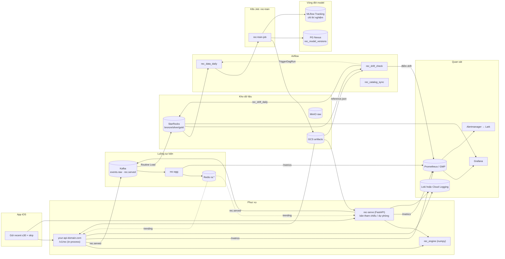
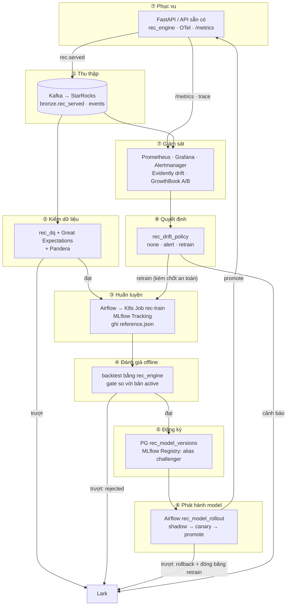
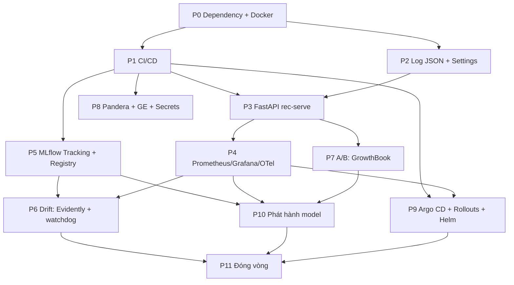
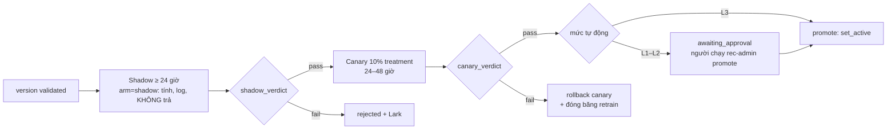
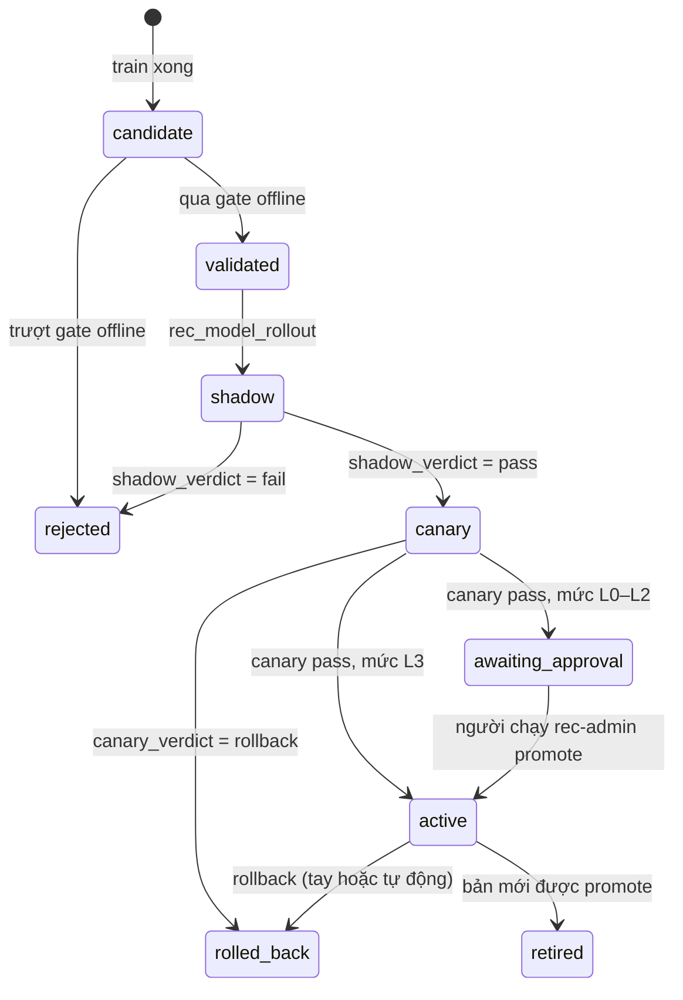

# Nâng cấp hệ thống lên các framework chuẩn công nghiệp và đóng vòng khép kín

> Phiên bản 1 · 2026-11-02 · Đối tượng đọc: kỹ sư ML/backend trong đội, chủ API `your-api-domain.com`, DE và Infra.
>
> **⚠️ Trạng thái tài liệu (đọc trước).** Đây là tài liệu *thiết kế và lộ trình* v1. Các mục **§1–§19 mô tả cấu trúc cũ** (`rec_pipeline`, `rec_engine`, `rec_serve` tách rời, `dags/`, `sql/`, `packages/`, file `01/02/03-*.md`) — nhiều đường dẫn và liên kết trong đó **không còn tồn tại** trong repo này, và đó là có chủ đích, không phải lỗi.
> Codebase hiện tại được dựng lại thành **một package `recsys`**. Muốn biết *hệ thống đang chạy thế nào*, đọc theo thứ tự: [README.md](../README.md) → [ARCHITECTURE.md](ARCHITECTURE.md) → [§20](#20-phụ-lục-v11-quyết-định-bổ-sung-khi-triển-khai-lại-từ-đầu) và [§21](#21-phụ-lục-v12-nối-dây-và-dọn-dẹp-trước-bàn-giao). Khi mâu thuẫn, **§21 > §20 > §1–§19**. Dùng §1–§19 để hiểu *vì sao* chọn công cụ và để lấy lộ trình cho phần chưa làm (Evidently, GrowthBook, Argo, Great Expectations…).

> Tài liệu này **thiết kế**, chưa phải code đã chạy. Mọi đoạn code trong đây là bản phác để làm theo, chưa được thử trong repo.
> Các con số hiệu năng lấy từ lần đo ngày 2026-11-02 (bundle tổng hợp 8.308 item, một process) và có ghi rõ nguồn.
>
> **Phiên bản 1 khác phiên bản 0 ở đâu.** Chủ dự án yêu cầu *tối đa hoá việc dùng framework* và *đóng thành một vòng khép kín gồm theo dõi, retrain, phát hành*. Vì vậy v1: (1) thêm §1.4, đối chiếu từng ý của nhận xét gốc với tài liệu; (2) đưa vào các framework mà v0 từng hoãn: MLflow Model Registry (dạng phản chiếu), Evidently làm bộ máy tính drift, GrowthBook, OpenTelemetry, Argo CD + Argo Rollouts, Helm, Great Expectations; (3) thêm §3.3 mô tả vòng khép kín và ba giai đoạn mới P9–P11; (4) sửa 8 lỗi của chính v0 (liệt kê ở §1.4).

## Mục lục

0. [Cách đọc tài liệu](#0-cách-đọc-tài-liệu)
1. [Kiểm chứng: hệ thống đã có gì, còn thiếu gì](#1-kiểm-chứng-hệ-thống-đã-có-gì-còn-thiếu-gì)
2. [Nguyên tắc nâng cấp](#2-nguyên-tắc-nâng-cấp)
3. [Kiến trúc đích, lựa chọn công cụ và vòng khép kín](#3-kiến-trúc-đích-lựa-chọn-công-cụ-và-vòng-khép-kín)
4. [Lộ trình và phụ thuộc giữa các giai đoạn](#4-lộ-trình-và-phụ-thuộc-giữa-các-giai-đoạn)
5. [P0 — Dependency và Docker](#5-p0--dependency-và-docker)
6. [P1 — CI/CD](#6-p1--cicd)
7. [P2 — Log có cấu trúc và cấu hình tập trung](#7-p2--log-có-cấu-trúc-và-cấu-hình-tập-trung)
8. [P3 — Serving bằng FastAPI](#8-p3--serving-bằng-fastapi)
9. [P4 — Quan sát hệ thống: Prometheus, Grafana, Alertmanager, OpenTelemetry](#9-p4--quan-sát-hệ-thống-prometheus-grafana-alertmanager)
10. [P5 — Theo dõi thí nghiệm và vòng đời model: MLflow](#10-p5--theo-dõi-thí-nghiệm-và-vòng-đời-model-mlflow)
11. [P6 — Drift và watchdog quyết định retrain: Evidently](#11-p6--drift-và-watchdog-quyết-định-retrain)
12. [P7 — A/B testing: GrowthBook](#12-p7--ab-testing)
13. [P8 — Kiểm tra dữ liệu và secrets: Pandera, Great Expectations, External Secrets](#13-p8--kiểm-tra-dữ-liệu-và-secrets-pandera-great-expectations-external-secrets)
14. [P9 — GitOps và phát hành code: Argo CD, Argo Rollouts, Helm](#14-p9--gitops-và-phát-hành-code-argo-cd-argo-rollouts-helm)
15. [P10 — Phát hành model: shadow → canary → promote/rollback](#15-p10--phát-hành-model-shadow--canary--promoterollback)
16. [P11 — Đóng vòng: tự động hoá có kiểm soát](#16-p11--đóng-vòng-tự-động-hoá-có-kiểm-soát)
17. [Những thứ cố ý không làm](#17-những-thứ-cố-ý-không-làm)
18. [Rủi ro, nghiệm thu, câu hỏi mở](#18-rủi-ro-nghiệm-thu-câu-hỏi-mở)
19. [Phụ lục: danh sách file thêm/sửa, thứ tự PR](#19-phụ-lục-danh-sách-file-thêmsửa-thứ-tự-pr)

---

## 0. Cách đọc tài liệu

- Muốn biết **nên làm gì trước**: đọc §1 (kết luận kiểm chứng) rồi §4 (lộ trình).
- Muốn **làm một giai đoạn**: đọc thẳng mục tương ứng (§5–§16). Mỗi mục có cùng khuôn: *Hiện trạng → Mục tiêu → Chọn gì và vì sao → Các bước → Nghiệm thu*.
- Muốn biết **mỗi framework nằm ở đâu trong vòng khép kín**: §3.3.
- Muốn biết **nhận xét gốc khớp hay lệch tài liệu ở chỗ nào**: §1.4.
- Muốn biết **vì sao không dùng công cụ X**: §17.

Quy ước: `✅ Đã có` (có bằng chứng trong repo), `🟡 Một phần`, `❌ Thiếu`, `⏭️ Không cần`.

---

## 1. Kiểm chứng: hệ thống đã có gì, còn thiếu gì

Hai nhận xét ban đầu (từ bạn của chủ dự án) cho rằng phần huấn luyện, orchestration, hạ tầng và kho dữ liệu đã khá đủ, còn thiếu vòng đời model, quan sát hệ thống và thử nghiệm. Tôi đọc lại code để đối chiếu từng ý. **Đa số đúng, nhưng có 4 chỗ nhận xét thiếu chính xác**, và chúng làm đổi thứ tự ưu tiên.

### 1.1 Bảng đối chiếu

| # | Nhận xét | Thực tế trong repo | Kết luận |
|---|---|---|---|
| 1 | Thiếu experiment tracking và model registry; không biết bản nào đang chạy, train từ dữ liệu nào, rollback về đâu | Registry **đã có**: bảng `rec_model_versions` + `rec_active` ([sql/postgres/02_rec_registry.sql](../../sql/postgres/02_rec_registry.sql)), `LocalRegistry`/`PostgresRegistry` ([registry.py](../../src/rec_pipeline/registry.py)), trạng thái `candidate→validated→active→rolled_back`, audit, `rec-admin promote/rollback/kill` ([admin.py](../../src/rec_pipeline/admin.py)). Mỗi artifact có manifest ghi `config_hash`, mã commit, digest image, cửa sổ dữ liệu, gate, backtest ([steps.py:92](../../src/rec_pipeline/steps.py#L92), [train_job.py](../../src/rec_pipeline/train_job.py)). **Thiếu thật**: theo dõi *thí nghiệm* (tune/ablation/learning-curve chỉ ghi file JSON; bảng `rec_runs` đã khai báo nhưng **không dòng code nào ghi vào**), không có giao diện so sánh run | 🟡 Một phần. Nhận xét sai nửa đầu |
| 2 | Thiếu serving layer thật, `http.server` chỉ để dev | `/v1/rec` **không thiếu mà nằm có chủ đích** trong API `your-api-domain.com` (thiết kế `01 §6.6`, chạy "in-process" trong API sẵn có). Hợp đồng, kill-switch, overload, fail-open đã đặc tả ([02 §12](02-TICH-HOP-PRODUCTION.md)). **Thiếu thật**: bản tham chiếu chạy được ở mức production trong repo này (devserver là stdlib, không semaphore ở bản cũ, không metrics) | 🟡 Một phần. Không phải "chưa có serving" |
| 3 | Thiếu monitoring/observability | **Đúng.** Không có `/metrics`, không có Prometheus/OTel trong code. Chỉ có thiết kế ([01 §6.9](01-THIET-KE-HE-THONG-RECOMMEND.md), [02 §15](02-TICH-HOP-PRODUCTION.md)) và heartbeat của `rec_agg`. Kênh dựng dashboard còn là câu hỏi mở (C7.2). **Lỗi cụ thể**: [train.Dockerfile](../../deploy/train.Dockerfile) đặt `RECSYS_LOG_JSON=1` nhưng không dòng code nào đọc biến này, nên log vẫn là text | ❌ Thiếu |
| 4 | Thiếu CI/CD | **Đúng.** Không có `.github/`, `.gitlab-ci.yml`. [03 INF-10](03-VIEC-CAN-LAM-NGOAI-REPO.md) ghi rõ: repo tự host ở `git.your-domain.com`, "hiện không có pipeline CI nào chạy". `make check` chỉ chạy tay. Build image chạy tay | ❌ Thiếu |
| 5 | Dependency không tái tạo được bằng một lệnh | **Đúng.** `uv.lock` chỉ có 16 package; `torch` và `lightfm` nằm ngoài `pyproject.toml` (phải qua [scripts/setup_env.sh](../../scripts/setup_env.sh)); `numpy` bị ghim `<2` và ghim lại lần cuối bằng tay; Airflow không khai báo; extra `realtime` (Kafka, Redis cho `rec_agg`) được docstring nhắc nhưng không tồn tại; `.venv` của repo trống, môi trường thật là `.venv-recsys`; **chỉ có một Dockerfile** (train) | ❌ Thiếu |
| 6 | Thiếu A/B testing và log impression | Phần lớn **đã có**: chia nhánh tất định `bucketing` + `validate_arms` ([rec_engine](../../src/rec_engine/bucketing.py)), `served_message` ghi `arm`, `model_version`, `config_hash`, `propensity` cho **mọi** request kể cả control/holdout/lỗi ([request.py](../../src/rec_engine/request.py)), bảng `rec_experiments`, SQL phân tích ITT ([gold_ab_daily.sql](../../sql/starrocks/transform/gold_ab_daily.sql)). **Thiếu**: topic `rec.served` + Routine Load do đội ngoài (NA-7), và kiểm định thống kê (SRM, khoảng tin cậy) | 🟡 Một phần |
| 7 | Data validation tự viết bằng if/else, khó mở rộng | DQ có cấu trúc: SQL tính `value`, [dags/rec_dq.py](../../dags/rec_dq.py) giữ ngưỡng và cờ `blocking`, có test, kết quả vào `gold.rec_dq_daily`. 10 check đang chạy (DQ0–DQ8, DQ10). **Thiếu**: DQ11 (PSI) và các check còn lại của `02 §8.5` chưa có trong `CHECKS` | 🟡 Đủ dùng. Great Expectations không cần |
| 8 | Thiếu drift detection; `rec_dq` chỉ kiểm null/schema/volume | **Đúng.** PSI chỉ có trong thiết kế (DQ11, ngưỡng 0,2). Không có hàm tính, không có snapshot tham chiếu lúc train. Đã có sẵn: gate so với bản đang active gồm cả `coverage` và `gini` ([gate.py](../../src/recsys/gate.py)) | ❌ Thiếu |
| 9 | Feature store tự chế, có nguy cơ training-serving skew | **Skew đã được xử lý đúng cách**: `rec_engine.features` là định nghĩa **duy nhất**, cả huấn luyện lẫn phục vụ import chung ([export/segments.py](../../src/recsys/export/segments.py), [config/preprocess.py](../../src/recsys/config/preprocess.py)), và backtest chạy bằng chính `rec_engine`. Đúng điều kiện bạn nêu ("dùng chung một hàm") | ⏭️ Không cần Feast |
| 10 | Cấu hình rải rác, cần Hydra/pydantic-settings | `AppConfig` là dataclass từ chối khoá lạ, có `config_hash`, sinh JSON Schema ([schemas.py](../../src/rec_pipeline/schemas.py)) — **tốt rồi**. Chỉ còn 36 chỗ `os.getenv`/`os.environ` với 25 biến `RECSYS_*` rải rác | 🟡 Chỉ cần gom biến môi trường. Hydra không cần |
| 11 | Secrets cần quản lý chuẩn | Job đọc DSN qua `secretKeyRef: rec-secrets` và Workload Identity ([train-job.yaml](../../deploy/k8s/train-job.yaml)). Secret `rec-secrets` do Infra tạo (INF-5). Khoá MinIO đặt trong shell | 🟡 Cần nối Secret Manager → K8s Secret |
| 12 | Retrain: lịch, eval gate, cooldown, feedback loop | **Đã có**: DAG chạy hằng ngày, DQ chặn train, version idempotent, gate (lift so với baseline, tụt so với active, coverage, gini, dung lượng), `auto_promote` mặc định `false`, explore `eps=0.05` kèm propensity để làm IPS. **Thiếu**: retrain kích bởi drift | 🟡 Một phần |

### 1.2 Bốn điểm nhận xét ban đầu nói chưa chính xác

1. **Registry đã có.** Nhưng cũng không nên để MLflow Model Registry *quyết định* "version nào đang chạy": `active.json` cạnh artifact là đường đọc của `RecRegistry` trong API, còn PG là nguồn sự thật có audit. Vì vậy ở §10 MLflow Registry chỉ là **bản phản chiếu một chiều** (hiển thị alias `challenger`/`production`/`previous`), PG vẫn là gốc.
2. **Serving không phải "chưa có".** Phương án đã chọn là nhúng vào API sẵn có. FastAPI trong repo này có hai vai: bản tham chiếu cho chủ API, và phương án dự phòng khi chạm ngưỡng tách (§8.1).
3. **Feature store không cần**, vì skew đã được chặn bằng thiết kế.
4. **Hai điểm lệch dependency** (extra `realtime`, Airflow ngoài `pyproject`) có thật. Ngoài ra còn phát hiện thêm lỗi `RECSYS_LOG_JSON` ở dòng 3 của bảng.

### 1.3 Thứ tự ưu tiên sau kiểm chứng

| Ưu tiên | Việc | Lý do |
|---|---|---|
| Cao | P0 Dependency + Docker, P1 CI | Mọi thứ khác dựa vào; chưa có thì không tin được kết quả của các bước sau |
| Cao | P2 Log có cấu trúc, P3 FastAPI + `/metrics`, P4 Prometheus/Grafana | Hệ gợi ý hỏng âm thầm: vẫn trả kết quả nhưng kém dần. Phải thấy được trước khi tối ưu |
| Cao | P6 Drift/watchdog | Cần log đầu ra (P2/P3) và snapshot tham chiếu (P5) làm nền |
| Trung bình | P5 MLflow Tracking | Có giá trị thật cho tune/ablation, nhưng hệ thống hiện vẫn truy vết được version nhờ registry |
| Trung bình | P7 A/B, P8 DQ/secrets | Phần lớn đã có, chỉ bổ sung |
| Cao (đóng vòng) | P9 GitOps, P10 phát hành model, P11 đóng vòng | Không có P10 thì vòng dừng ở "đăng ký model": thiếu mắt xích đưa model mới lên phục vụ an toàn (`02 §13`, ML-5) |

### 1.4 Đối chiếu từng ý của nhận xét với tài liệu này

Nhận xét gốc gồm hai lượt (lượt 1: danh sách thiếu theo mức ưu tiên; lượt 2: vòng drift → retrain). Bảng dưới đối chiếu **từng ý** với v0 và v1 của tài liệu.

Ký hiệu: **✔** khớp nhận xét · **➕** v1 mở rộng thêm so với v0 · **≠** khác nhận xét *có chủ đích* (lý do nêu ở cột ghi chú) · **✖** không dùng (lý do ở §17).

#### Lượt 1 — danh sách thiếu

| # | Ý trong nhận xét | v0 | v1 | Ghi chú |
|---|---|---|---|---|
| 1 | MLflow (tracking) | Có | ✔ Có | P5 |
| 2 | MLflow **model registry**, alias `production` | Không (chỉ Tracking) | ➕ Có, **dạng phản chiếu một chiều** từ PG | PG `rec_model_versions` + `active.json` vẫn là nguồn sự thật vì API đọc `active.json`; MLflow hiển thị alias `challenger`/`production`/`previous` do `set_active` cập nhật. Không để hai nơi cùng quyết định |
| 3 | W&B thay MLflow | Không | ✖ | Trùng chức năng với MLflow |
| 4 | FastAPI + uvicorn: validation, healthcheck, timeout | Có | ✔ Có | P3. Validation vẫn đi qua `rec_engine.request.parse_request` vì hợp đồng v1 **không trả 4xx** (lỗi request vào `reason` trong body `200`); pydantic chỉ để sinh OpenAPI. Pydantic mặc định trả `422` sẽ phá hợp đồng này |
| 5 | BentoML (tuỳ chọn) | Không | ✖ | Artifact là file numpy nạp bằng mmap, không có gì để "đóng gói model" |
| 6 | Prometheus + Grafana | Có | ✔ Có | P4 |
| 7 | OpenTelemetry (trace) | Hoãn | ➕ **Có** | P4 §9.5, lấy mẫu có đuôi (tail sampling) để chi phí thấp |
| 8 | `structlog` | Có | ✔ Có | P2 |
| 9 | CI: GitHub Actions / GitLab CI | Có | ✔ Có | P1; v1 bổ sung các pipeline còn thiếu theo thiết kế `02 §18.2` (xem §6.3b) |
| 10 | Helm **hoặc** Kustomize | Kustomize | ➕ **Cả hai** | Kustomize cho manifest tự viết (Job, Deployment). Helm cho chart bên thứ ba (MLflow, External Secrets, Argo, GrowthBook) |
| 11 | Argo CD (GitOps trên GKE) | Chỉ khi ≥ 2 dịch vụ | ➕ **Có** | P9. Kèm Argo Rollouts cho phát hành *code* |
| 12 | Khai báo đủ extra `realtime`, `train`, **`airflow`** | Có `train`, `realtime`, `serve`, `monitor`, `tracking`; **không** `airflow` | ≠ Giữ không có `airflow` trong `pyproject` | Airflow có constraints riêng, xung đột với `recommenders` (ghim `numpy<2`). Thay bằng constraints chính thức + test import DAG trong CI. Image Airflow do Nexus sở hữu |
| 13 | Dockerfile multi-stage cho `train`, `serve`, **`dag`** | `serve`, `train`, `agg`, `monitor` | ≠ Không có image `dag` | DAG được đồng bộ vào Airflow của Nexus (git-sync), không đóng thành image. Có thêm `agg` và `monitor` mà nhận xét không nêu |
| 14 | Dùng constraints file chính thức của Airflow | Có | ✔ Có | §5.3 bước 2 |

#### Lượt 1 — ưu tiên trung bình và thấp

| # | Ý trong nhận xét | v0 | v1 | Ghi chú |
|---|---|---|---|---|
| 15 | A/B: GrowthBook, Statsig, **hoặc tự làm** bucket hoá | Tự làm | ➕ **GrowthBook làm lớp phân tích** | Gán nhánh vẫn do `rec_engine.bucketing` (không dùng SDK GrowthBook để chia nhánh, tránh hai nơi quyết định). GrowthBook đọc `bronze.rec_served` làm bảng exposure. P7 |
| 16 | Data validation: Great Expectations hoặc Pandera | Chỉ Pandera | ➕ **Cả hai** | Pandera cho DataFrame trong Python; Great Expectations cho bảng StarRocks (pha 2). `rec_dq.py` giữ vai trò *chính sách* (ngưỡng, cờ chặn). P8 |
| 17 | Drift: Evidently | Tự viết PSI; Evidently chỉ báo cáo | ➕ **Evidently là bộ máy tính** | Chính sách quyết định (`rec_drift_policy.py`) vẫn tự viết vì là nghiệp vụ. Hàm PSI tự viết giữ lại làm *chuẩn đối chiếu* trong test để nâng cấp Evidently an toàn. P6 |
| 18 | Feast, nếu skew là vấn đề thật | Không | ✖ Giữ nguyên | Skew đã bị chặn bằng `rec_engine.features` dùng chung. Đây chính là phương án "giữ cách hiện tại, dùng chung một hàm tính feature" mà nhận xét nêu. Phân tích ở §17 |
| 19 | `pydantic-settings` hoặc Hydra | `pydantic-settings` | ✔ Có; Hydra ✖ | `AppConfig` đã có xác thực khoá lạ, hash, JSON Schema |
| 20 | Secrets: Secret Manager / External Secrets | Có | ✔ Có | P8 |
| 21 | ANN (Faiss, HNSWlib) khi catalog lớn | Không | ✔ Không | Khớp: catalog 8.308 item, engine ~1 ms |
| 22 | DVC/lakeFS/Iceberg; ghi snapshot vào metadata MLflow | Ghi snapshot vào manifest + MLflow | ✔ Có | §10.5 |
| 23 | Mô hình hiện đại (two-tower, sequential, TorchRec) | Không | ✔ Không | Khớp |
| 24 | Kubeflow, Ray, Triton là thừa | Không | ✔ Không | Khớp |

#### Lượt 2 — vòng drift → retrain

| # | Ý trong nhận xét | v0 | v1 | Ghi chú |
|---|---|---|---|---|
| 25 | App + endpoint `/metrics` | Có | ✔ Có | P3, P4 |
| 26 | Prometheus; job batch đẩy qua Pushgateway | Có | ✔ Có | §9.3 |
| 27 | Log/trace: Loki hoặc ELK; OTel + Tempo/Jaeger | Cloud Logging; không trace | ➕ Cloud Logging mặc định (Loki tuỳ chọn); **OTel → Cloud Trace hoặc Tempo** | Chọn Cloud Logging vì GKE đã tự thu; Loki chỉ thêm khi cần truy vấn chéo. §9.5 |
| 28 | Grafana + Alertmanager → Slack/email | → Lark | ≠ Lark | Hệ thống dùng Lark (thiết kế `01 §6.9`) |
| 29 | Log input/output/impression vào Kafka → StarRocks/GCS | Có (`rec.served`) | ✔ Có | Hợp đồng đã có; topic và Routine Load do đội ngoài (NA-7) |
| 30 | Snapshot thống kê của tập train, lưu cùng model trong MLflow | `reference.json` trong artifact + MLflow | ✔ Có, **lưu cả hai nơi** | Trong artifact để DAG đọc không cần MLflow; trong MLflow để người xem. §11.2 |
| 31 | Evidently chạy như DAG Airflow, ghi điểm drift ra Prometheus | PSI tự viết | ➕ Evidently trong `rec_drift_check` | §11.5 |
| 32 | `BranchOperator`: drift **hoặc** metric tụt → `TriggerDagRun(train)` | Drift **và** metric tụt, kèm chốt an toàn | ≠ Chặt hơn nhận xét | Chính nhận xét (mục riêng cho recsys #2) cũng nói "chỉ tự động retrain khi drift đi kèm metric tụt"; nên bản "hoặc" ở sơ đồ nhận xét mâu thuẫn với phần chữ của nó. Tài liệu theo phần chữ |
| 33 | "Đừng chỉ nhìn drift của feature đầu vào" | Hai tầng (đầu vào, đầu ra) | ✔ Có | §11.3 |
| 34 | Drift ≠ model xấu đi | Có | ✔ Có | §11.4 |
| 35 | Label đến chậm → proxy metric | Có | ✔ Có | §11.3 mục 3 |
| 36 | Chặn retrain liên tục: cooldown, dữ liệu tối thiểu, eval gate | Có | ✔ Có | `decide()`; gate đã có sẵn trong repo |
| 37 | Vòng phản hồi → giữ explore | Có | ✔ Có | `eps=0,05` kèm propensity; holdout 5% |
| 38 | Vẫn giữ retrain theo lịch | Có | ✔ Có | DAG `rec_data_daily` giữ nguyên |
| 39 | Thứ tự: deps/Docker → CI → FastAPI + log → MLflow → Prometheus/Grafana → drift DAG → A/B | P0, P1, P2, P3, P4, P5, P6, P7 | ✔ Gần như trùng | Khác: nhận xét xếp MLflow trước Prometheus, v0 xếp sau. Hai việc độc lập nhau nên v1 cho phép chạy song song (§4) |

#### Điều tài liệu có mà nhận xét không nói tới

- **Mắt xích cuối của vòng: đưa model mới lên phục vụ an toàn.** Nhận xét dừng ở "đăng ký MLflow". Thiết kế (`02 §13`) yêu cầu shadow 24 giờ → canary 10% → promote hoặc auto-rollback, và mục ML-5 trong `03` ghi đây là việc *chưa có code*. v0 bỏ sót hẳn mắt xích này; v1 bổ sung ở P10.
- Kill-switch, blocklist, `rec-admin explain/simulate/diff`; holdout vĩnh viễn 5%; log propensity để làm IPS.
- Ràng buộc GIL khi cấu hình serving (`REC_MAX_INFLIGHT=2`), và yêu cầu load test HTTP thật (§8.2, §8.4).
- Hai lỗi sẵn có trong repo: `RECSYS_LOG_JSON` không có tác dụng; và retrain ngoài lịch cùng ngày dữ liệu sẽ bị bỏ qua vì version trùng (`--revision`, §11.4).

#### Lỗi tìm thấy trong chính tài liệu v0 (đã sửa trong v1)

| # | Lỗi | Sửa |
|---|---|---|
| 1 | Dẫn `[01 §10]` cho giám sát. `01 §10` là "Các phương án đã cân nhắc"; giám sát nằm ở `01 §6.9` | Sửa hai chỗ |
| 2 | Gán "phương án A1" cho quyết định chạy in-process. A1 là cách *nạp artifact* | Đã sửa |
| 3 | §11.2 nói thêm `reference.json` chỉ cần "khai trong manifest, không đổi code". Thực tế `write_artifact` chỉ ghi các file nó biết rồi quét thư mục | Thêm trường `reference` vào `ArtifactPayload` và hằng số `schema.REFERENCE` ([writer.py](../../src/rec_engine/writer.py)). Sửa ở §11.2 |
| 4 | `Settings` thiếu `rec_max_inflight`, trong khi manifest K8s dùng `REC_MAX_INFLIGHT` còn devserver đọc `REC_MAX_INFLIGHT` | Thống nhất `REC_MAX_INFLIGHT` (không tiền tố) |
| 5 | CI thiếu các pipeline của `02 §18.2`: train end-to-end trên dữ liệu tổng hợp, schema cấu hình khớp code, PR chạm `sql/`, nightly, release wheel `rec_engine` và image | Bổ sung §6.3b |
| 6 | Bỏ sót `02 §13` (shadow → canary → auto-rollback) | P10 |
| 7 | "Đóng vòng" ở v0 §11 dừng ở bước kích train, chưa tới bước đưa model lên phục vụ | §3.3, P10, P11 |
| 8 | §10.4 nói lưu `mlflow_run_id` trong `ModelVersion.data`. Bảng PG **đã có cột `rec_run_id`** nhưng `PostgresRegistry.record` không bao giờ ghi vào nó | Dùng đúng cột `rec_run_id`: thêm trường vào `ModelVersion` và vào câu `INSERT`. Sửa ở §10.4 |

---

## 2. Nguyên tắc nâng cấp

1. **Lõi `rec_engine` chỉ phụ thuộc numpy.** Đây là tài sản lớn nhất: chạy được trong API sẵn có, dễ test, không kéo theo pandas/torch. Mọi framework mới (FastAPI, prometheus_client, pydantic, MLflow) nằm **ngoài** lõi. Hiện chưa có test cưỡng chế điều này ([test_layering.py](../../tests/unit/test_layering.py) chỉ canh `recsys`→`recsys_demo`); §6 thêm test.
2. **Một nguồn sự thật cho mỗi khái niệm.** Version đang chạy: PG. Hợp đồng request: `rec_engine.request`. Ngưỡng DQ: `dags/rec_dq.py`. Công cụ mới không được tạo bản thứ hai.
3. **Công cụ mới phải nối vào một mắt xích của vòng khép kín (§3.3) và giải một việc ta chưa làm tốt hơn.** Mỗi mục có cột "Chọn gì và vì sao". Công cụ không nối vào mắt xích nào thì ghi vào §17 kèm điều kiện để xem lại.
4. **Mọi tích hợp ngoài phải tắt được.** `MLFLOW_TRACKING_URI` không đặt thì train vẫn chạy (no-op); `REC_METRICS=0` thì không mở cổng metrics. Máy dev và CI không cần hạ tầng.
5. **Đo trước, đặt ngưỡng sau.** Các ngưỡng cảnh báo ở §9 lấy từ thiết kế hoặc số đo; ngưỡng chưa đo ghi rõ "đặt tạm, chỉnh sau 2 tuần dữ liệu".
6. **Mỗi giai đoạn là một chuỗi PR nhỏ, tự đứng được** và có nghiệm thu bằng lệnh chạy được.

---

## 3. Kiến trúc đích, lựa chọn công cụ và vòng khép kín

### 3.1 Sơ đồ



### 3.2 Bảng chọn công cụ (v1)

Nguyên tắc chọn ở v1: **dùng framework ở mọi chỗ nó nối được vào một mắt xích của vòng khép kín (§3.3)**; không dùng framework chỉ vì nó phổ biến.

| Nhu cầu | Chọn | Vai trò chính xác | Không chọn |
|---|---|---|---|
| Web framework | **FastAPI + uvicorn** | Phục vụ `/v1/rec`, `/search`, `/sort_lessons`, `/healthz`, `/readyz`, `/metrics` | BentoML, Flask |
| Metrics | **`prometheus_client`** + Prometheus (GKE: Google Managed Prometheus) + **Pushgateway** | Pull từ dịch vụ; job batch đẩy qua Pushgateway | StatsD, Datadog |
| Dashboard, cảnh báo | **Grafana + Alertmanager → Lark** | Đọc cả Prometheus lẫn StarRocks (giao thức MySQL) | Tự dựng |
| Log | **`structlog`** bọc stdlib logging → Cloud Logging | JSON, có `model_version`, `request_id`, `trace_id` | Thay lời gọi `logger.*`; Loki (chỉ tuỳ chọn) |
| Trace | **OpenTelemetry** (SDK + OTLP) → Collector → Cloud Trace hoặc Tempo | Nối `request_id` ↔ trace ↔ `rec.served`; tail sampling | Jaeger tự host |
| Experiment tracking | **MLflow Tracking** (tự host) | Params, metric, artifact của train/tune/ablation | W&B |
| Vòng đời model | **MLflow Model Registry** *(phản chiếu một chiều từ PG)* | Hiển thị alias `challenger`/`production`/`previous`; liên kết run ↔ version | Để MLflow quyết định "version nào active" |
| Drift | **Evidently** (bộ máy tính) + `rec_drift_policy.py` (chính sách tự viết) | Evidently tính PSI/KS/JS và báo cáo; policy quyết định cảnh báo hay retrain | NannyML, Alibi Detect (trùng Evidently) |
| Kiểm dữ liệu | **Pandera** (DataFrame) + **Great Expectations** (bảng StarRocks, pha 2); `rec_dq.py` giữ chính sách | Pandera chặn khuôn cột trước khi train; GE tính pass/fail trên bảng | Viết thêm SQL kiểm tay |
| A/B testing | Gán nhánh: `rec_engine.bucketing`. Phân tích: **GrowthBook** (tự host) | Exposure từ `bronze.rec_served`; SRM, khoảng tin cậy, Bayes/tần suất | Statsig (trùng); SDK GrowthBook để chia nhánh |
| CI | **GitLab CI** (hoặc Gitea Actions, cùng ý) | Lint, kiểu, test, benchmark, build, quét | Jenkins |
| Build image | **kaniko** + **Trivy** | Không cần Docker daemon; quét lỗ hổng | — |
| Manifest | **Kustomize** (của ta) + **Helm** (chart bên thứ ba) | Job, Deployment, overlay stg/prod; MLflow, GrowthBook, ESO, Argo | Chỉ Helm hoặc chỉ Kustomize |
| GitOps | **Argo CD** | Trạng thái cụm = trạng thái Git | `kubectl apply` tay |
| Phát hành *code* | **Argo Rollouts** + AnalysisTemplate (Prometheus) | Canary image `rec-serve`, tự abort khi chỉ số xấu | — |
| Phát hành *model* | **Airflow** DAG `rec_model_rollout` | shadow → canary → promote/rollback (thiết kế `02 §13`) | Argo Rollouts (model đổi bằng dữ liệu `active.json`, không bằng image) |
| Điều phối | **Airflow** (có sẵn) + `KubernetesPodOperator` | Vòng nền, drift, rollout | Kubeflow, Argo Workflows |
| Dependency | **uv workspace** + `uv.lock` + constraints Airflow | Tái tạo môi trường bằng một lệnh | Poetry |
| Secrets | **External Secrets Operator** ← GCP Secret Manager; **gitleaks** | Không DSN trong repo/image/log | Sealed Secrets |
| Cấu hình | **pydantic-settings** | Gom 25 biến `RECSYS_*` | Hydra |
| Load test | **k6** (hoặc Locust) | Smoke hằng đêm, tải đầy đủ trước khi mở lưu lượng | — |

### 3.3 Vòng chu trình khép kín

Mục này là phần mới của v1. Nó trả lời: *"mỗi framework nằm ở đâu trong vòng, và cái gì quyết định chuyển từ bước này sang bước kia?"*



| Bước | Vào | Công cụ | Ra | Điều kiện sang bước sau | Quyết định ở đâu |
|---|---|---|---|---|---|
| ① Thu thập | Request phục vụ, event app | Kafka, Routine Load, `rec-agg` | `bronze.rec_served`, `silver.rec_interactions` | Luôn chạy | Hợp đồng `served_message` |
| ② Kiểm dữ liệu | Bảng silver/gold | `rec_dq`, Great Expectations, Pandera | `gold.rec_dq_daily` | Mọi check *chặn* đạt | [rec_dq.py](../../dags/rec_dq.py) |
| ③ Huấn luyện | Dữ liệu đạt DQ | Airflow, K8s Job, MLflow Tracking | Artifact, `reference.json`, run MLflow | Job thành công | `rec_data_daily` (lịch) hoặc `rec_drift_check` (ngoài lịch) |
| ④ Đánh giá | Artifact backtest | `backtest`, `gate` | `validated` hoặc `rejected` | Qua gate | [gate.py](../../src/recsys/gate.py) |
| ⑤ Đăng ký | Version `validated` | `registry.record`, mirror MLflow | Dòng PG, alias `challenger` | Ghi thành công | `rec_pipeline.registry` |
| ⑥ Phát hành model | Version `validated` | `rec_model_rollout` | `active` hoặc `rolled_back` | Shadow đạt → canary đạt → duyệt theo mức tự động (L0–L3) | `rec_rollout_policy.py` |
| ⑦ Phục vụ, giám sát | Traffic | FastAPI, Prometheus, OTel, Evidently, GrowthBook | Metric, trace, điểm drift, kết quả A/B | Luôn chạy | Luật cảnh báo, `rec_drift_policy.py` |
| ⑧ Quyết định | Điểm drift, metric proxy, trạng thái rollout | `rec_drift_check` | `none`/`alert`/`retrain` | Chốt an toàn (§11.4) | `rec_drift_policy.py` |

**Năm vòng lồng nhau** (không phải một vòng duy nhất, vì chu kỳ khác nhau):

| Vòng | Chu kỳ | Kích bởi | Kết thúc ở |
|---|---|---|---|
| V1 Nền | Hằng ngày 01:00 VN | Lịch | Version `validated` hoặc `rejected` |
| V2 Drift | Mỗi 6 giờ | Lịch | `none`, `alert`, hoặc `retrain` (quay về V1 với `--revision`) |
| V3 Phát hành model | Sau mỗi version `validated` | Sự kiện | `active` hoặc `rolled_back` |
| V4 Phát hành code | Mỗi merge vào nhánh chính | CI | Image mới lên production, hoặc Argo Rollouts tự abort |
| V5 Thí nghiệm | Theo tuần | Người | Quyết định giữ hay bỏ một thay đổi thiết kế model (A/B kéo dài, GrowthBook) |

**Mức tự động hoá.** Vòng khép kín không có nghĩa là không có người. Mỗi app chọn một mức, tăng dần khi đã có bằng chứng:

| Mức | Hành vi | Điều kiện lên mức này |
|---|---|---|
| **L0** (hiện tại) | Train hằng ngày tự động; `promote` bằng tay (`auto_promote=false`) | — |
| **L1** | Thêm drift check tự động; chỉ **cảnh báo**, người quyết retrain và promote | Xong P4, P5, P6 |
| **L2** | Drift + metric tụt + chốt an toàn → **tự retrain**; shadow và canary tự chạy; **promote cần người duyệt** (`approved_by`) | Xong P10; game day (§16.4) đạt |
| **L3** | Canary đạt → **tự promote**; trượt → tự rollback; người chỉ nhận thông báo | Theo thiết kế `02 §13`: gate và canary ổn định ≥ 14 ngày liên tiếp ở L2 |

Pilot không vượt L1 trong hai tuần đầu (cũng là quy định của thiết kế).

**Nguồn sự thật cho từng thứ** (mỗi thứ đúng một nơi; các nơi khác chỉ phản chiếu):

| Thứ | Nguồn sự thật | Phản chiếu sang |
|---|---|---|
| Version đang phục vụ | PG `rec_active` | `active.json` (đường đọc của API), alias MLflow `production` |
| Trạng thái rollout | PG `rec_experiments` + `rec_rollouts` | Metric Prometheus |
| Tham số, metric của một lần chạy | MLflow | `rec_model_versions.rec_run_id` trỏ tới |
| Phân phối tham chiếu của version | `reference.json` trong artifact | Artifact MLflow |
| Ngưỡng DQ | `dags/rec_dq.py` | — |
| Ngưỡng drift, rollout | `rec_drift_policy.py`, `rec_rollout_policy.py` | Dashboard hiển thị |
| Hợp đồng request | `rec_engine.request` | OpenAPI (sinh ra) |
| Gán nhánh A/B | `rec_engine.bucketing` | GrowthBook (chỉ đọc kết quả) |
| Cấu hình app | `AppConfig` JSON + `config_hash` | JSON Schema |
| Image đang chạy | Git (repo triển khai) | Argo CD |

---

## 4. Lộ trình và phụ thuộc giữa các giai đoạn



| Giai đoạn | Sản phẩm chính | Công sức ước tính* | Chặn bởi bên ngoài? |
|---|---|---|---|
| P0 | Extras đầy đủ, Dockerfile nhiều giai đoạn, `rec-engine` tách wheel | 3–4 ngày | Không |
| P1 | Pipeline CI đủ bộ theo `02 §18.2`, test cưỡng chế `rec_engine` chỉ numpy, benchmark, Kustomize | 4–5 ngày | **Có**: chọn hệ CI (INF-10), runner |
| P2 | JSON log, `Settings` tập trung | 1–2 ngày | Không |
| P3 | `rec-serve`: FastAPI, `/healthz` `/readyz` `/metrics`, image `serve` | 4–5 ngày | Không (dev); Infra nếu deploy |
| P4 | Metric, dashboard, luật cảnh báo, Alertmanager→Lark, **OpenTelemetry** | 5–6 ngày | **Có**: C7.2, kênh Lark, đích trace |
| P5 | `tracking.py`, log từ train/tune/ablation, MLflow trên GKE, **mirror Registry**, ghi `rec_run_id` | 4–5 ngày | Infra (DB, bucket) |
| P6 | `reference.json`, **adapter Evidently**, DAG `rec_drift_check`, nhánh retrain, `--revision` | 6–8 ngày | **Có**: cần `rec.served` thật (NA-7) cho tầng đầu ra |
| P7 | **GrowthBook** nối StarRocks, SRM, báo cáo A/B | 4–5 ngày | NA-7; kiểm kết nối MySQL → StarRocks |
| P8 | Pandera, **Great Expectations**, External Secrets, gitleaks | 4–6 ngày | Infra |
| P9 | **Argo CD**, Helm values, **Argo Rollouts** + AnalysisTemplate | 3–4 ngày | Infra; Q-SERVE (có tự deploy `rec-serve` không) |
| P10 | DAG `rec_model_rollout`, `rec_rollout_policy.py`, lệnh `rec-admin experiment`, bảng `rec_rollouts` | 5–6 ngày | **Có**: API phải hỗ trợ nhánh `shadow`/`canary` (API-4, iOS-7) |
| P11 | Mạch nối, bộ ngắt mạch, game day, SLO của vòng | 3–4 ngày | Không |

\* Công sức là ước tính của người viết tài liệu cho một kỹ sư quen codebase, chưa đo thật. Chưa gồm thời gian chờ đội ngoài. Tổng khoảng 45–60 ngày công; có thể song song hoá thành khoảng 8–10 tuần với 2 người.

**Có thể làm song song:** P2 với P1; P5 với P3/P4; P8 với P3–P7. **Không nên đảo:** P6 sau P4/P5 (cần log đầu ra và snapshot tham chiếu); P10 sau P5 (cần registry mirror) và P4 (cần metric); P11 cuối cùng.

---

## 5. P0 — Dependency và Docker

### 5.1 Hiện trạng

- `uv.lock` 16 package, không có `torch`, `lightfm`, Airflow, Kafka, Redis.
- `lightfm` chỉ có sdist hỏng dưới PEP 517 → `setup_env.sh` tải sdist, vá `setup.py`, build tại chỗ. `torch` lấy từ index riêng.
- `numpy<2` vì `recommenders==1.2.1` còn dùng `np.NaN`. (Một test lỗi ngay trong lần chạy gần đây đúng vì lý do này khi môi trường có NumPy 2.)
- Một Dockerfile (train). `rec-agg`, serve, DAG, monitor chưa có image.
- `rec_engine` được đóng chung wheel với `recsys` (`[tool.hatch.build.targets.wheel]`), trong khi thiết kế muốn cài **riêng** wheel `rec-engine` vào image API.

### 5.2 Mục tiêu

`uv sync --extra <vai trò>` dựng được môi trường đúng cho từng vai trò; mỗi vai trò có image nhỏ nhất đủ chạy; `rec-engine` là một distribution riêng chỉ phụ thuộc numpy.

### 5.3 Các bước

**Bước 1 — Tách `rec-engine` bằng uv workspace.**

Cấu trúc:

```
packages/
  rec-engine/
    pyproject.toml          # chỉ numpy
    src/rec_engine/...      # chuyển từ src/rec_engine
pyproject.toml              # gốc: recsys, rec_pipeline, rec_agg, rec_serve...
```

`packages/rec-engine/pyproject.toml`:

```toml
[project]
name = "rec-engine"
version = "1.0.0"                      # = rec_engine.schema.ENGINE_VERSION
description = "Lõi phục vụ gợi ý: chỉ numpy, hàm thuần"
requires-python = ">=3.11"
dependencies = ["numpy>=1.26"]         # chạy được numpy 1.26 và 2.x (02 §12)

[build-system]
requires = ["hatchling"]
build-backend = "hatchling.build"

[tool.hatch.build.targets.wheel]
packages = ["src/rec_engine"]
```

`pyproject.toml` gốc:

```toml
[tool.uv.workspace]
members = ["packages/rec-engine"]

[tool.uv.sources]
rec-engine = { workspace = true }
```

và thêm `"rec-engine"` vào `dependencies`, bỏ `"src/rec_engine"` khỏi `packages` của hatch. Cập nhật `ruff.src`, `mypy.files`, `known-first-party` cho đúng đường dẫn mới. Chạy `make test-engine` để chắc import không đổi.

> **Rủi ro:** đổi đường dẫn thư mục chạm nhiều cấu hình và doc. Làm trong **một PR riêng, chỉ di chuyển**, không sửa logic. Nếu thấy quá tốn, có phương án nhẹ: giữ nguyên thư mục và phát hành wheel `rec-engine` từ CI bằng `hatch build` với một file `pyproject` thứ hai. Phương án workspace rõ ràng hơn nên được ưu tiên.

**Bước 2 — Khai báo đủ extra.**

```toml
[project.optional-dependencies]
# vai trò -> thứ cần cài
train = [
  "pandas>=2.2", "scipy>=1.11", "recommenders==1.2.1", "cornac>=2.0",
  "lightgbm>=4.0", "scikit-learn>=1.3", "hyperopt>=0.2.7", "pyarrow>=14",
  "lightfm",                          # xem bước 3
]
warehouse = ["pymysql>=1.1", "psycopg[binary]>=3.1", "google-cloud-storage>=2.10", "s3fs>=2024.1"]
realtime  = ["confluent-kafka>=2.4", "redis>=5.0"]                  # cho rec-agg (đang thiếu)
serve     = ["fastapi>=0.115", "uvicorn[standard]>=0.30", "prometheus-client>=0.20",
             "structlog>=24.1", "confluent-kafka>=2.4", "redis>=5.0"]
monitor   = ["pandas>=2.2", "pyarrow>=14", "evidently>=0.4", "pymysql>=1.1"]
tracking  = ["mlflow-skinny>=2.14"]                                 # nhẹ, chỉ client
demo      = ["gradio>=5.0,<6", "pillow>=10", "requests>=2.31"]
analysis  = ["matplotlib>=3.8", "seaborn>=0.13"]
dev       = ["pytest>=8", "pytest-cov>=5", "ruff>=0.6", "mypy>=1.10", "pre-commit>=3.7"]
```

Ghi chú phiên bản: các số tối thiểu ở trên là **gợi ý**, cần chốt bằng `uv lock` và chạy test, đặc biệt `evidently` (API đổi nhiều giữa các bản) và `mlflow-skinny`.

Airflow **không** khai báo trong `pyproject`: nó chạy trong image/môi trường Airflow của Nexus, có constraints riêng. Thay vào đó thêm file `dags/requirements-test.txt` và test import DAG trong CI (§6.3) với constraints chính thức:

```bash
AIRFLOW_VERSION=<đúng phiên bản Nexus đang chạy>
PY=3.11
uv pip install "apache-airflow==${AIRFLOW_VERSION}" \
  --constraint "https://raw.githubusercontent.com/apache/airflow/constraints-${AIRFLOW_VERSION}/constraints-${PY}.txt"
```

**Bước 3 — Đưa `torch` và `lightfm` vào lockfile.**

`torch` bản CPU qua index riêng:

```toml
[[tool.uv.index]]
name = "pytorch-cpu"
url = "https://download.pytorch.org/whl/cpu"
explicit = true

[tool.uv.sources]
torch = { index = "pytorch-cpu" }
```

Bản GPU (CUDA 12.1) cho máy dev có GPU dùng index `https://download.pytorch.org/whl/cu121` qua một extra riêng `train-gpu`. Hai extra này xung đột nhau, khai báo bằng `[tool.uv] conflicts` để uv không cố giải chung.

`lightfm`: cách sạch nhất là **một fork nhỏ trên git server đã vá `setup.py`**, ghim theo commit:

```toml
[tool.uv.sources]
lightfm = { git = "https://git.your-domain.com/your-org/lightfm-patched.git", rev = "<commit>" }

[tool.uv]
no-build-isolation-package = ["lightfm"]   # nếu bản vá cần numpy có sẵn khi build
```

> **Chưa thử.** Hai thao tác này (đặc biệt `conflicts` và `no-build-isolation-package`) cần thử trong một nhánh riêng. Nếu uv không giải được, phương án lùi là **build wheel `lightfm` đã vá một lần trong CI, đẩy vào Artifact Registry** làm index riêng. Dù chọn cách nào, mục tiêu là xoá bước "tải sdist rồi vá tại chỗ" khỏi `setup_env.sh`.

**Bước 4 — Dockerfile nhiều giai đoạn, một file cho mọi vai trò.**

`deploy/Dockerfile`:

```dockerfile
# syntax=docker/dockerfile:1.7
ARG PY=3.11-slim

# ---- builder: cài vào /opt/venv rồi chép sang image sạch ----------------------
FROM python:${PY} AS builder
RUN apt-get update && apt-get install -y --no-install-recommends build-essential \
 && rm -rf /var/lib/apt/lists/* && pip install --no-cache-dir uv
ENV UV_PROJECT_ENVIRONMENT=/opt/venv UV_COMPILE_BYTECODE=1 UV_LINK_MODE=copy
WORKDIR /app
COPY pyproject.toml uv.lock README.md ./
COPY packages/ packages/

# ---- serve: chỉ numpy + fastapi, KHÔNG pandas/torch ---------------------------
FROM builder AS serve-build
RUN --mount=type=cache,target=/root/.cache/uv \
    uv sync --frozen --no-dev --no-install-project --extra serve
COPY src/ src/
RUN --mount=type=cache,target=/root/.cache/uv uv sync --frozen --no-dev --extra serve

FROM python:${PY} AS serve
RUN useradd -r -u 10001 rec
COPY --from=serve-build /opt/venv /opt/venv
COPY --from=serve-build /app/src /app/src
ENV PATH=/opt/venv/bin:$PATH PYTHONUNBUFFERED=1 RECSYS_LOG_JSON=1
USER 10001
EXPOSE 8080
CMD ["uvicorn", "rec_serve.app:create_app", "--factory", "--host", "0.0.0.0", "--port", "8080"]

# ---- train: bản hiện tại của deploy/train.Dockerfile, chuyển vào đây ----------
FROM builder AS train-build
RUN --mount=type=cache,target=/root/.cache/uv \
    uv sync --frozen --no-dev --extra train --extra warehouse --extra tracking
COPY src/ src/ 
COPY configs/ configs/
FROM python:${PY} AS train
COPY --from=train-build /opt/venv /opt/venv
COPY --from=train-build /app /app
ENV PATH=/opt/venv/bin:$PATH PYTHONUNBUFFERED=1 RECSYS_LOG_JSON=1 \
    RECSYS_INCLUDE_DEMO_EVENTS=0 RECSYS_FAST=0 RECSYS_SPLIT_MODE=global
ENTRYPOINT ["rec-train-job"]

# ---- agg: rec-agg (Kafka -> Redis) --------------------------------------------
FROM builder AS agg-build
RUN uv sync --frozen --no-dev --extra realtime
COPY src/ src/
FROM python:${PY} AS agg
COPY --from=agg-build /opt/venv /opt/venv
COPY --from=agg-build /app/src /app/src
ENV PATH=/opt/venv/bin:$PATH
ENTRYPOINT ["rec-agg"]

# ---- monitor: DAG drift + báo cáo Evidently -----------------------------------
FROM builder AS monitor-build
RUN uv sync --frozen --no-dev --extra monitor
COPY src/ src/
FROM python:${PY} AS monitor
COPY --from=monitor-build /opt/venv /opt/venv
COPY --from=monitor-build /app/src /app/src
ENV PATH=/opt/venv/bin:$PATH
ENTRYPOINT ["rec-drift"]
```

Build theo vai trò: `docker build --target serve -t <registry>/rec-serve:<sha> -f deploy/Dockerfile .`. Mỗi image được tham chiếu **theo digest**, không dùng `latest` (đúng với quy ước hiện có của DAG).

> Ghi chú: `rec-agg` và `rec-drift` là các entry point **mới** (§9.4, §11.5). Dockerfile ở đây phác theo ý đồ; chỉnh `COPY` cho đúng khi các module đã có. Khi xong, xoá [deploy/train.Dockerfile](../../deploy/train.Dockerfile) và cập nhật [deploy/README.md](../../deploy/README.md).

**Bước 5 — Dọn `setup_env.sh` và Makefile.**

Khi `uv sync --extra train --extra dev` chạy được, `make setup` rút còn:

```makefile
setup:           ## Dựng môi trường dev đầy đủ
	uv sync --extra train --extra warehouse --extra demo --extra analysis --extra dev --extra tracking
```

Xoá các bước "ghim lại numpy bằng tay". Đồng thời đổi biến `VENV := .venv-recsys` thành `.venv` mặc định của uv để hết cảnh hai thư mục môi trường.

### 5.4 Nghiệm thu P0

- [ ] Máy sạch: `git clone && uv sync --extra train --extra dev && make test-fast` đạt, **không** chạy thêm script nào.
- [ ] `docker build --target serve` cho image **không chứa** pandas/torch/cornac (kiểm bằng `pip list` trong container). Ghi lại dung lượng.
- [ ] `rec-engine` cài được riêng: `uv pip install ./packages/rec-engine` rồi `python -c "import rec_engine"` trong venv chỉ có numpy.
- [ ] `docs` và `deploy/README.md` trỏ đúng đường dẫn mới.

---

## 6. P1 — CI/CD

### 6.1 Hiện trạng và mục tiêu

Không có pipeline nào (INF-10). `make check` chạy `ruff`, `mypy`, `pytest tests/unit` nhưng chỉ khi có người nhớ chạy. Mục tiêu: mọi MR tự chạy lint, kiểm kiểu, test, benchmark; nhánh chính tự build image và đẩy lên Artifact Registry theo digest.

### 6.2 Chọn hệ CI

Repo ở git server (tự host). Chưa biết là GitLab hay Gitea nên phác theo **GitLab CI**; nếu là Gitea Actions thì cú pháp gần với GitHub Actions và các job dưới đây chuyển gần như nguyên xi (cùng lệnh). Đây là **câu hỏi mở Q-CI** (§15).

### 6.3 Pipeline

`.gitlab-ci.yml`:

```yaml
stages: [lint, test, build, scan, publish]

default:
  image: ghcr.io/astral-sh/uv:python3.11-bookworm-slim   # hoặc image nội bộ
  cache:
    key: { files: [uv.lock] }
    paths: [.cache/uv]
variables:
  UV_CACHE_DIR: $CI_PROJECT_DIR/.cache/uv

lint:
  stage: lint
  script:
    - uv sync --extra dev
    - uv run ruff check .
    - uv run ruff format --check .
    - uv run mypy

# Lõi chỉ numpy: chạy với CẢ numpy 1.26 và 2.x (02 §12, câu hỏi Q20)
test-engine:
  stage: test
  parallel:
    matrix:
      - NUMPY: ["1.26.4", "2.1.3"]
  script:
    - uv venv && uv pip install ./packages/rec-engine pytest "numpy==${NUMPY}"
    - PYTHONPATH=tests:tests/unit uv run --no-sync pytest tests/unit/rec_engine tests/unit/test_layering.py -q

test-unit:
  stage: test
  script:
    - uv sync --extra train --extra dev --extra demo
    - uv run pytest tests/unit -q --cov=src --cov-report=xml
  coverage: '/TOTAL.*\s+(\d+%)$/'

# Chặn hồi quy hiệu năng (ML-7): p95 engine < 5 ms
bench-engine:
  stage: test
  script:
    - uv sync --extra dev
    - uv run python tests/bench/bench_engine.py --max-p95-ms 5 --out bench.json
  artifacts: { paths: [bench.json], expire_in: 30 days }

dag-import:
  stage: test
  script:
    - uv venv
    - uv pip install "apache-airflow==${AIRFLOW_VERSION}" --constraint "${AIRFLOW_CONSTRAINTS_URL}"
    - uv pip install -e . pendulum
    - uv run --no-sync python -c "from airflow.models import DagBag; b=DagBag('dags', include_examples=False); assert not b.import_errors, b.import_errors"

build-images:
  stage: build
  rules: [{ if: '$CI_COMMIT_BRANCH == $CI_DEFAULT_BRANCH' }]
  image: gcr.io/kaniko-project/executor:debug
  parallel: { matrix: [{ TARGET: [serve, train, agg, monitor] }] }
  script:
    - /kaniko/executor --context . --dockerfile deploy/Dockerfile --target $TARGET
        --destination $REGISTRY/rec-$TARGET:$CI_COMMIT_SHORT_SHA
        --digest-file digest-$TARGET.txt
  artifacts: { paths: ["digest-*.txt"] }

scan:
  stage: scan
  rules: [{ if: '$CI_COMMIT_BRANCH == $CI_DEFAULT_BRANCH' }]
  script:
    - trivy image --exit-code 1 --severity HIGH,CRITICAL $REGISTRY/rec-serve:$CI_COMMIT_SHORT_SHA

publish-digests:
  stage: publish
  rules: [{ if: '$CI_COMMIT_BRANCH == $CI_DEFAULT_BRANCH' }]
  script:
    - ./scripts/ci/publish_digests.sh   # ghi digest vào Airflow Variable rec_train_image (xem 6.5)
```

### 6.3b Các pipeline còn thiếu so với thiết kế `02 §18.2`

Pipeline ở §6.3 mới là phần chạy trên mỗi MR. Thiết kế đã yêu cầu thêm các pipeline sau; v0 bỏ sót:

| Pipeline | Bước | Chặn khi | Ghi chú triển khai |
|---|---|---|---|
| `train-e2e-synthetic` (MR) | `make train-job APP=local` trên dữ liệu tổng hợp: fit → backtest bằng `rec_engine` → gate → publish vào thư mục tạm; kiểm có `_SUCCESS`, `manifest.json`, `reference.json` (từ P6) | fail | Chạy được không cần hạ tầng; đây là bài kiểm đường train đầu-cuối rẻ nhất |
| `schemas-check` (MR) | `make schemas` rồi `git diff --exit-code` trên các JSON Schema sinh ra | lệch | Chặn quên sinh lại schema cấu hình khi đổi dataclass |
| `sql-staging` (MR chạm `sql/`) | Chạy SQL trên StarRocks **staging** với fixture 1 ngày, so với golden | lệch | Cần staging (INF-9) |
| `nightly` | Integration, parity, train 7 ngày ở staging, **load test k6** (smoke, 5 phút, 3× tải thường) | fail → Lark | k6 script ở `tests/load/rec.js` |
| `release-engine` (tag `engine-v*`) | Build wheel `rec-engine`, chạy bộ golden trên numpy 1.26 **và** 2.x, đẩy lên Artifact Registry | lệch | Chủ API cài wheel này vào image API |
| `release-images` (tag `v*`) | Build, quét, đẩy image `serve`/`train`/`agg`/`monitor`, ghi digest | — | Digest là thứ duy nhất DAG và Argo CD được phép tham chiếu |

### 6.4 Hai test cần thêm để CI có giá trị

**1. `rec_engine` chỉ được import numpy và stdlib** — mở rộng [test_layering.py](../../tests/unit/test_layering.py):

```python
def test_rec_engine_chi_phu_thuoc_numpy_va_stdlib():
    allowed = set(sys.stdlib_module_names) | {"numpy", "rec_engine", "__future__"}
    offenders = {
        f"{path.name}: {name}"
        for path in (SRC / "rec_engine").rglob("*.py")
        for name in _top_level_imports(path)
        if name not in allowed
    }
    assert not offenders, f"rec_engine kéo thêm phụ thuộc: {sorted(offenders)}"
```

(Dùng chung hàm `_top_level_imports` đã có trong file.) Đây là cách cưỡng chế nguyên tắc 1, và nó cũng sẽ phát hiện sớm nếu ai đó vô tình `import pandas` trong lõi.

**2. Benchmark engine** — `tests/bench/bench_engine.py`: dựng bundle tổng hợp 8.308 item (3 model k=64, i2i K=50) như kịch bản đo ngày 2026-11-02, chạy 300 request ở `limit=20` và `limit=100`, thoát mã khác 0 nếu p95 vượt `--max-p95-ms`. Số đo hiện tại (một process, một thread, máy dev 12 nhân):

| `limit` | p50 | p95 |
|---|---|---|
| 20 | ~0,6 ms | ~0,7 ms |
| 100 | ~0,9 ms | ~0,9 ms |
| 200 | ~1,2 ms | ~1,4 ms |

Ngưỡng CI nên đặt **rộng hơn nhiều** số đo (runner dùng chung chậm và nhiễu hơn), ví dụ 5 ms như ML-7, để bắt hồi quy lớn chứ không báo động giả. Ngưỡng này sẽ được siết sau khi có vài tuần số liệu từ runner thật.

### 6.5 CD: đưa image mới vào hệ thống

Thứ tự thao tác khi một commit lên nhánh chính:

1. CI build 4 image, ghi `digest-*.txt`.
2. Với **train**: DAG dùng `{{ var.value.rec_train_image }}` (đã ghim digest). Bước `publish-digests` cập nhật Airflow Variable **qua một MR tự động vào repo cấu hình** hoặc qua `airflow variables set` do service account CI giữ. Ưu tiên cách MR để có lịch sử và duyệt.
3. Với **serve** (khi ta deploy) và các thành phần hạ tầng (MLflow, GrowthBook, External Secrets, OTel Collector): **Argo CD** theo dõi repo triển khai và đồng bộ lên cụm (P9, §14). CI chỉ việc mở MR cập nhật digest trong overlay `stg`; `prod` cần bấm duyệt.

Kustomize cho Job huấn luyện — thay `envsubst` thủ công ở [train-job.yaml](../../deploy/k8s/train-job.yaml):

```
deploy/k8s/
  base/            namespace-quota.yaml, train-job.yaml, kustomization.yaml
  overlays/stg/    kustomization.yaml  (bucket -stg, stg_rec_*)
  overlays/prod/   kustomization.yaml
```

```yaml
# overlays/prod/kustomization.yaml
resources: [../../base]
images:
  - name: rec-train
    digest: sha256:<điền bởi CI>
replacements: []   # APP_SLUG vẫn do DAG điền; chỉ digest/bucket đi qua overlay
```

### 6.6 Nghiệm thu P1

- [ ] Một MR cố tình `import pandas` trong `rec_engine` bị chặn bởi `test-engine`.
- [ ] Một MR cố tình làm `diversify` chậm 10 lần bị chặn bởi `bench-engine`.
- [ ] `dag-import` đỏ khi một DAG import hỏng.
- [ ] Merge vào nhánh chính sinh image có digest, quét Trivy không còn HIGH/CRITICAL (hoặc có ngoại lệ được ghi).
- [ ] Pre-commit hook `unit-tests` không còn phụ thuộc đường dẫn cứng `.venv-recsys/bin/python` (đổi sang `uv run`).

---

## 7. P2 — Log có cấu trúc và cấu hình tập trung

### 7.1 Log JSON (sửa lỗi `RECSYS_LOG_JSON`)

**Hiện trạng:** [logging_config.py](../../src/recsys/logging_config.py) chỉ có định dạng text; Dockerfile đặt `RECSYS_LOG_JSON=1` nhưng không ai đọc.

**Chọn:** `structlog` đặt phía trên stdlib logging bằng `ProcessorFormatter`. Mọi lời gọi `logger.info("[job] %s", x)` hiện có **giữ nguyên**; chỉ phần định dạng đầu ra đổi.

```python
# src/recsys/logging_config.py  (bổ sung)
import os
import structlog


def _json_enabled() -> bool:
    return os.getenv("RECSYS_LOG_JSON", "0") == "1"


def build_formatter() -> logging.Formatter:
    shared = [
        structlog.stdlib.add_log_level,
        structlog.stdlib.add_logger_name,
        structlog.processors.TimeStamper(fmt="iso", utc=True),
    ]
    renderer = (
        structlog.processors.JSONRenderer()
        if _json_enabled()
        else structlog.dev.ConsoleRenderer(colors=False)
    )
    return structlog.stdlib.ProcessorFormatter(
        foreign_pre_chain=shared,
        processors=[
            structlog.stdlib.ProcessorFormatter.remove_processors_meta,
            renderer,
        ],
    )
```

`setup_logging` dùng `build_formatter()` cho handler. Giữ `structlog` là **phụ thuộc tuỳ chọn**: nếu không import được thì rơi về formatter cũ, để thư viện `recsys` không bắt buộc kéo `structlog` (nguyên tắc 4).

**Trường chuẩn trong log của job/service:** `app`, `model_version`, `request_id`, `dag_run_id`, `surface`, `reason`. Dùng `structlog.contextvars.bind_contextvars(...)` ở đầu job/request để mọi dòng tự mang theo.

**Lưu ý quyền riêng tư:** không log `device_id` thô ở mức INFO; log đã băm hoặc cắt. `served_message` đã được thiết kế không chứa IP ([request.py](../../src/rec_engine/request.py)), giữ nguyên quy ước đó cho log ứng dụng.

### 7.2 `Settings` tập trung cho biến môi trường

**Hiện trạng:** 36 chỗ đọc `os.getenv`/`os.environ`, 25 biến `RECSYS_*` rải rác. `AppConfig` (cấu hình theo app) đã tốt và **không đổi**.

**Chọn:** một lớp `pydantic-settings` ở tầng `rec_pipeline` (không phải `rec_engine`) liệt kê, kiểu hoá và ghi tài liệu mọi biến môi trường:

```python
# src/rec_pipeline/settings.py
from pydantic import Field, SecretStr
from pydantic_settings import BaseSettings, SettingsConfigDict


class Settings(BaseSettings):
    model_config = SettingsConfigDict(env_prefix="RECSYS_", extra="ignore")

    data_source: str = "synthetic"
    artifact_uri: str = "artifacts/serving"
    starrocks_dsn: SecretStr | None = None
    pg_dsn: SecretStr | None = None
    log_json: bool = False
    split_mode: str = "global"
    code_commit: str | None = None
    image_digest: str = "local"
    dq_passed: bool = True
    # --- mới, cho các giai đoạn sau ---
    mlflow_tracking_uri: str | None = Field(None, alias="MLFLOW_TRACKING_URI")
    metrics_enabled: bool = True
    rec_max_inflight: int = Field(
        2, alias="REC_MAX_INFLIGHT"
    )  # không tiền tố RECSYS_ (khớp devserver)
    otlp_endpoint: str | None = Field(None, alias="OTEL_EXPORTER_OTLP_ENDPOINT")
```

`SecretStr` làm cho DSN không bao giờ lộ qua `repr` hoặc log. Cách chuyển: thay dần từng `os.getenv` bằng `get_settings().x` (bọc `lru_cache`), mỗi PR một module. Không cần làm một lần.

> `pydantic-settings` là phụ thuộc của `rec_pipeline`, **không** của `rec_engine`.

### 7.3 Nghiệm thu P2

- [ ] `RECSYS_LOG_JSON=1 rec-train-job ...` in mỗi dòng là JSON hợp lệ (kiểm bằng `| jq -e .`).
- [ ] `RECSYS_LOG_JSON` không đặt thì log giữ dạng text như cũ.
- [ ] `grep -rn "os.getenv" src/rec_pipeline` còn lại ≤ số biến không thuộc `Settings`.
- [ ] In `Settings()` không lộ DSN.

---

## 8. P3 — Serving bằng FastAPI

### 8.1 Vị trí trong kiến trúc

Quyết định đã có (thiết kế `01 §6.6`): chạy `rec_engine` **bên trong** `your-api-domain.com`. Mục này **không thay đổi quyết định đó**. `rec-serve` có hai vai:

1. **Bản tham chiếu chạy được** cho chủ API, thay `rec-devserver` (stdlib, chỉ cho dev).
2. **Phương án dự phòng** nếu chạm ngưỡng tách (`01 §6.6`): CPU của `/v1/rec` > 30% CPU node, hoặc p95 `/v1/events` tăng đo được. Khi đó deploy `rec-serve` thành dịch vụ riêng.

### 8.2 Ràng buộc từ số đo (rất quan trọng khi cấu hình)

Engine chạy dưới GIL. Đo ngày 2026-11-02, một process, bundle 8.308 item:

| Số thread cùng gọi engine | req/s | p50 | Bị giảm chất lượng do quá `deadline_s` | Quá 50 ms |
|---|---|---|---|---|
| 1 | 941 | 1,0 ms | 0% | 0% |
| 2 | 954 | 1,9 ms | 0% | 0% |
| 8 | 450 | 13 ms | 2,6% | 0,4% |
| 16 | 372 | 40 ms | 46% | 38% |

Hệ quả cho thiết kế `rec-serve`:

- **`REC_MAX_INFLIGHT = 2` mỗi process** (mặc định đã đặt trong [devserver.py](../../src/rec_pipeline/devserver.py)). Tăng số này làm *giảm* thông lượng.
- **Scale bằng process và pod**, không bằng thread: `uvicorn --workers N` với N ≈ số nhân. Đo trước đó cho thấy 4 process cho khoảng 4 lần thông lượng một process.
- Artifact mở bằng `mmap` nên các worker cùng pod dùng chung page cache, RAM không nhân theo số worker.
- Con số này chỉ có giá trị cho đến khi đo lại trên **artifact thật** và qua HTTP; xem nghiệm thu.

### 8.3 Cấu trúc module

```
src/rec_serve/
  __init__.py
  app.py          # create_app(): lifespan, route, middleware
  service.py      # RecService: logic thuần, KHÔNG biết HTTP (tách từ devserver)
  registry.py     # RecRegistry: refresh nền 60 s, swap nguyên tử
  sinks.py        # ServedSink: Kafka (prod) | JSONL (dev) | Null (test)
  metrics.py      # định nghĩa metric prometheus
  models.py       # pydantic: chỉ để sinh OpenAPI và response_model
```

**Bước 1 — Tách logic khỏi HTTP.** `RecService` và `ArtifactRegistry` hiện nằm trong [devserver.py](../../src/rec_pipeline/devserver.py). Chuyển vào `rec_serve/service.py` và `rec_serve/registry.py`; `devserver.py` import lại từ đó. Test hiện có ở [test_pipeline_ops.py](../../tests/unit/test_pipeline_ops.py) vẫn phải đạt nguyên văn.

**Bước 2 — Registry nạp ở nền.** Hiện tại `refresh()` chạy **trong thread của request đầu tiên sau mỗi 60 giây**, kể cả tải artifact và tính sha256 toàn bộ file. Với `rec-serve`, nạp ở thread nền:

```python
# rec_serve/registry.py  (phác)
class RecRegistry:
    def __init__(self, storage, app_slug, cache_dir, interval_s=60, jitter_s=120):
        self._state = _State(
            bundle=None, overrides={}
        )  # đổi nguyên tử bằng gán một tham chiếu
        ...

    def start(self) -> None:
        threading.Thread(target=self._loop, name="rec-registry", daemon=True).start()

    def _loop(self) -> None:
        while not self._stop.wait(self._interval + random.uniform(0, self._jitter)):
            try:
                self._refresh_once()
            except Exception:
                REGISTRY_LOAD_FAILURES.inc()
                log.exception("registry.refresh_failed")  # giữ bản cũ

    @property
    def state(
        self,
    ) -> _State:  # đọc không cần khoá: gán tham chiếu là nguyên tử trong CPython
        return self._state
```

Giữ tối đa 2 version trên đĩa, kiểm `_SUCCESS` và sha256 (đã có trong `rec_engine.load`).

**Bước 3 — Ứng dụng FastAPI.**

```python
# rec_serve/app.py  (phác)
from __future__ import annotations
import asyncio, time, uuid
from concurrent.futures import ThreadPoolExecutor
from contextlib import asynccontextmanager

from fastapi import FastAPI, Request, Response
from prometheus_client import CONTENT_TYPE_LATEST, generate_latest

from rec_serve import metrics
from rec_serve.models import RecResponse
from rec_pipeline.settings import get_settings

HARD_TIMEOUT_S = 0.05  # 02 §12.2


def create_app() -> FastAPI:
    settings = get_settings()

    @asynccontextmanager
    async def lifespan(app: FastAPI):
        app.state.registry = build_registry(settings)
        app.state.registry.start()
        app.state.sink = build_sink(settings)  # Kafka hoặc JSONL
        app.state.service = RecService(app.state.registry, app.state.sink)
        app.state.pool = ThreadPoolExecutor(max_workers=settings.rec_max_inflight)
        yield
        app.state.sink.close()  # xả hàng đợi trước khi tắt

    app = FastAPI(title="rec-serve", lifespan=lifespan)

    @app.post("/v1/rec", response_model=RecResponse, response_model_exclude_none=True)
    async def rec(request: Request) -> dict:
        t0 = time.perf_counter()
        body = await request.body()  # bytes thô: đưa thẳng cho parse_request
        country = request.headers.get("x-country")  # GeoIP do tầng trước (LB) gán
        loop = asyncio.get_running_loop()
        # service.handle: parse -> chia nhánh -> overload? -> engine(deadline) -> log rec.served.
        # Hết slot trả reason=overload ngay (KHÔNG xếp hàng).
        fut = loop.run_in_executor(
            app.state.pool, app.state.service.handle, body, country
        )
        try:
            payload = await asyncio.wait_for(asyncio.shield(fut), HARD_TIMEOUT_S)
        except asyncio.TimeoutError:
            payload = app.state.service.timeout_response(
                body
            )  # reason=timeout, vẫn log
        metrics.LATENCY.observe(time.perf_counter() - t0)
        return payload

    @app.get("/healthz")  # sống: process còn chạy
    def healthz() -> dict:
        return {"ok": True}

    @app.get("/readyz")  # sẵn sàng: đã nạp bundle (hoặc ghi nhận "không có artifact")
    def readyz(response: Response) -> dict:
        ready = app.state.registry.ready
        response.status_code = 200 if ready else 503
        return {"ready": ready, "version": app.state.registry.version}

    @app.get("/metrics")
    def prometheus() -> Response:
        return Response(generate_latest(), media_type=CONTENT_TYPE_LATEST)

    return app
```

Các điểm thiết kế cần giữ:

- **`wait_for(shield(fut))`** như mẫu §12.2: hết hạn thì trả lời client ngay nhưng thread engine vẫn chạy nốt. Semaphore chỉ nhả khi *thread* xong (không phải khi client bị timeout), để không tích tụ công việc vô hình.
- **Fail-open:** mọi nhánh lỗi trả `200` kèm `items: []` và `reason` (hợp đồng v1: client chỉ có một đường xử lý). Không trả `5xx` cho lỗi nghiệp vụ.
- **Mọi nhánh đều log `rec.served`** (kể cả control/holdout/lỗi) — điều kiện để phân tích ITT.
- **`/search`, `/sort_lessons`** đăng ký cùng cách và **dùng chung** semaphore và deadline (đã làm ở devserver).
- Dùng **pydantic chỉ cho `response_model`** để có OpenAPI. Phần nhận request vẫn đi qua `rec_engine.request.parse_request` (nguyên tắc 2).
- `ServedSink` Kafka: hàng đợi có giới hạn, **đầy thì bỏ và đếm** `rec_served_dropped_total`, không bao giờ chặn request.

**Bước 4 — Chạy thật.**

```bash
# dev
rec-serve --app local --port 8080
# prod trong container: một process uvicorn / nhân, KHÔNG dùng nhiều thread để "tăng tải"
uvicorn rec_serve.app:create_app --factory --host 0.0.0.0 --port 8080 --workers ${WORKERS:-4}
```

Thêm vào `pyproject.toml`: `rec-serve = "rec_serve.cli:main"`.

**Bước 5 — Manifest K8s cho phương án tách.**

```yaml
apiVersion: apps/v1
kind: Deployment
metadata: { name: rec-serve, namespace: rec }
spec:
  replicas: 3
  strategy: { rollingUpdate: { maxUnavailable: 0, maxSurge: 1 } }
  template:
    spec:
      serviceAccountName: rec-serve                # Workload Identity, chỉ đọc GCS rec/*
      containers:
        - name: serve
          image: <registry>/rec-serve@sha256:<digest>
          env:
            - { name: WORKERS, value: "4" }
            - { name: REC_MAX_INFLIGHT, value: "2" }
          ports: [{ containerPort: 8080, name: http }]
          readinessProbe: { httpGet: { path: /readyz, port: http }, periodSeconds: 5 }
          livenessProbe:  { httpGet: { path: /healthz, port: http }, periodSeconds: 10 }
          resources:
            requests: { cpu: "4", memory: 1Gi }     # đo lại; artifact ~30 MB nên RAM nhỏ
            limits:   { memory: 2Gi }
          volumeMounts: [{ name: cache, mountPath: /var/cache/rec }]
      volumes: [{ name: cache, emptyDir: { sizeLimit: 1Gi } }]
---
apiVersion: autoscaling/v2
kind: HorizontalPodAutoscaler
metadata: { name: rec-serve, namespace: rec }
spec:
  scaleTargetRef: { apiVersion: apps/v1, kind: Deployment, name: rec-serve }
  minReplicas: 2
  maxReplicas: 8
  metrics:
    - type: Resource
      resource: { name: cpu, target: { type: Utilization, averageUtilization: 60 } }
---
apiVersion: policy/v1
kind: PodDisruptionBudget
metadata: { name: rec-serve, namespace: rec }
spec: { minAvailable: 1, selector: { matchLabels: { app: rec-serve } } }
```

Ghi chú: giá trị `requests/limits` là khởi điểm, **chưa đo**. Giống INF-8 của Job, chốt sau lần chạy đầu.

### 8.4 Kiểm thử và nghiệm thu P3

- [ ] Toàn bộ test `test_pipeline_ops.py` về route `/v1/rec`, `/search`, `/sort_lessons` đạt sau khi tách `RecService`.
- [ ] Test mới bằng `fastapi.testclient.TestClient`: `bad_request`, `no_artifact`, `kill_switch`, `control`, `holdout`, `overload` (chiếm hết slot), `timeout`, `error` đều trả `200` với `reason` đúng và **đều ghi một dòng `rec.served`**.
- [ ] `/readyz` trả `503` khi chưa có artifact và `200` sau khi nạp.
- [ ] **Load test thật** bằng `k6` hoặc `locust` qua HTTP, trên artifact thật, ở 1×, 3×, 10× tải đỉnh dự kiến (900 QPS ở thiết kế `01 §9.2`): p95 `/v1/rec` < 30 ms (G2), tỷ lệ `reason=overload|timeout` < 1% ở tải đỉnh, không pod nào bị OOM. **Số đo hiện tại chỉ là engine thuần; mục này mới là bằng chứng chịu tải.**
- [ ] Kill-switch và rollback có hiệu lực ≤ 60 giây (đã là tiêu chí của gói G).

---

## 9. P4 — Quan sát hệ thống: Prometheus, Grafana, Alertmanager

### 9.1 Mục tiêu

Thấy được 4 lớp (kỹ thuật, dữ liệu, model, kinh doanh — [02 §15](02-TICH-HOP-PRODUCTION.md)) và cảnh báo trước khi người dùng thấy. Lưu ý: hệ gợi ý hỏng âm thầm (vẫn trả kết quả, kém dần), nên ngoài latency/lỗi cần metric về *nội dung* trả ra.

### 9.2 Hệ nào chạy dashboard? (Q-OBS, câu hỏi mở C7.2)

Thiết kế hiện nói "Cloud Monitoring → Lark"; C7.2 hỏi dùng Grafana, Superset, `nexus-bi` hay GCP Monitoring. Đề xuất, để chủ hạ tầng chốt:

| Phương án | Ưu | Nhược |
|---|---|---|
| **A. Google Managed Prometheus + Grafana** (đề xuất nếu chạy GKE) | Không tự vận hành Prometheus; `PodMonitoring` khai báo bằng YAML; Grafana đọc được cả StarRocks | Thêm một Grafana nếu chưa có |
| B. Chỉ Cloud Monitoring | Ít thành phần | Metric tuỳ biến theo nhãn nhiều chiều kém linh hoạt; không đọc được StarRocks |
| C. Tự host kube-prometheus-stack | Toàn quyền | Tốn vận hành, không cần ở quy mô này |

Phần còn lại của mục viết theo A; chuyển sang B/C chỉ đổi nơi khai báo scrape và luật.

### 9.3 Metric

**Dịch vụ phục vụ** (`rec_serve/metrics.py`; tên theo [02 §12.4/§15](02-TICH-HOP-PRODUCTION.md)):

| Metric | Loại | Nhãn | Ý nghĩa |
|---|---|---|---|
| `rec_requests_total` | Counter | `app, surface, arm, tier, reason` | Số request; `reason` rỗng = thành công |
| `rec_latency_seconds` | Histogram | `surface` | Độ trễ toàn handler. Bucket: 1, 2, 5, 10, 20, 30, 50, 80, 150 ms |
| `rec_engine_seconds` | Histogram | `surface` | Riêng thời gian engine |
| `rec_inflight` | Gauge | — | Số slot đang dùng |
| `rec_degraded_total` | Counter | `reason` (`deadline`, `empty_pool`) | Kết quả bị giảm chất lượng. **Metric quan trọng nhất cho "hỏng âm thầm"** |
| `rec_registry_version_info` | Gauge (=1) | `app, model_version` | Version đang phục vụ |
| `rec_registry_load_failures_total` | Counter | `app` | Nạp artifact lỗi |
| `rec_registry_age_seconds` | Gauge | `app` | Thời gian từ lần nạp thành công gần nhất |
| `rec_request_invalid_total` | Counter | `field` | Request sai, theo trường |
| `rec_unknown_item_ratio` | Gauge | `app` | Tỷ lệ id lạ trong `recent` (catalog lệch app) |
| `rec_served_dropped_total` | Counter | — | Log `rec.served` bị bỏ do hàng đợi đầy |
| `rec_empty_total` | Counter | `reason` | Trả rỗng (để tính tỷ lệ rỗng) |

**Nội dung trả ra** (cho phát hiện suy giảm âm thầm), tính trên cửa sổ trượt trong process hoặc bằng SQL trên `bronze.rec_served`: `rec_served_item_gini`, `rec_top1pct_exposure_share`, `rec_catalog_coverage`, `rec_src_share{src}` (tỷ lệ nhãn nguồn `rec_group/rec_content/rec_trend/rec_explore`), `rec_tier_share{tier}`.

**`rec-agg`:** thêm `prometheus_client.start_http_server(9100)` và 3 metric: `recagg_lag_seconds`, `recagg_events_total{result}` (lấy từ `batch.counters`: `applied`, `unmapped`, `unknown_item`, `late`, `skip_app`), `recagg_flush_seconds`. Hiện các số này chỉ vào dòng log ([runner.py](../../src/rec_agg/runner.py)).

**Job batch (huấn luyện, drift):** đẩy qua Pushgateway ở cuối job: `rec_train_last_success_timestamp`, `rec_train_gate_passed`, `rec_train_ndcg`, `rec_drift_psi{feature}`. Với drift còn **ghi bảng `gold.rec_drift_daily`** để Grafana vẽ lịch sử từ StarRocks (§11).

### 9.4 Cảnh báo

Các ngưỡng đầu tiên lấy từ [01 §6.9](01-THIET-KE-HE-THONG-RECOMMEND.md). Ngưỡng chưa có trong thiết kế đánh dấu *tạm*.

```yaml
groups:
  - name: rec-serving
    rules:
      - alert: RecLatencyP95High
        expr: histogram_quantile(0.95, sum by (le) (rate(rec_latency_seconds_bucket[5m]))) > 0.050
        for: 10m
        labels: { severity: page }
        annotations: { summary: "p95 /v1/rec > 50 ms trong 10 phút" }

      - alert: RecEmptyRateHigh
        expr: |
          sum(rate(rec_empty_total{reason!~"control|holdout"}[10m]))
          / sum(rate(rec_requests_total[10m])) > 0.20
        for: 10m
        labels: { severity: page }

      - alert: RecDegradedRateHigh                # tạm: 5%, chỉnh sau 2 tuần dữ liệu
        expr: sum(rate(rec_degraded_total[10m])) / sum(rate(rec_requests_total[10m])) > 0.05
        for: 15m
        labels: { severity: ticket }

      - alert: RecRegistryLoadFailing
        expr: increase(rec_registry_load_failures_total[15m]) > 3
        labels: { severity: page }

      - alert: RecModelStale                      # tạm: 36 giờ, vì train chạy mỗi ngày
        expr: time() - rec_train_last_success_timestamp > 36 * 3600
        labels: { severity: ticket }

  - name: rec-agg
    rules:
      - alert: RecAggLagHigh
        expr: recagg_lag_seconds > 300
        for: 5m
        labels: { severity: page }
      - alert: RecAggHeartbeatLost
        expr: absent(recagg_lag_seconds) or time() - recagg_last_flush_timestamp > 120
        labels: { severity: page }
```

**Alertmanager → Lark.** Lark có webhook "custom bot" nhưng định dạng khác Alertmanager, nên dùng một bộ chuyển (ví dụ `alertmanager-webhook-adapter` hoặc một hàm Cloud Run nhỏ) rồi trỏ `webhook_configs` tới đó. Định tuyến theo `severity`: `page` → kênh P1, `ticket` → kênh P2 (kênh do PM cấp, câu hỏi mở C7.2).

**Dashboard Grafana** (4 hàng, mỗi hàng một lớp): ① QPS, p50/p95/p99, tỷ lệ `reason`, `rec_inflight`, `rec_degraded`; ② DQ0–DQ10 từ `gold.rec_dq_daily`, PSI từ `gold.rec_drift_daily`; ③ Gini, coverage, phân bố tier/src theo `model_version`; ④ KPI theo nhánh từ `gold.rec_ab_daily`. Lưu JSON dashboard vào repo (`deploy/grafana/`) để có lịch sử thay đổi.

### 9.5 Log và trace

**Log.** JSON từ P2 đi thẳng stdout; GKE tự đẩy vào Cloud Logging. Mỗi dòng mang `trace_id` (xem dưới) và `model_version`. Loki chỉ là tuỳ chọn, thêm khi cần truy vấn log chéo mà Cloud Logging không đáp ứng; nếu đã chọn Grafana thì có thể đọc Cloud Logging bằng datasource sẵn có.

**Trace (OpenTelemetry), làm từ v1.** Mục đích: trả lời "request chậm hoặc bị giảm chất lượng ở bước nào", và **nối ba thứ với nhau**: trace ↔ dòng log ↔ dòng `rec.served`.

- **Gói:** `opentelemetry-sdk`, `opentelemetry-exporter-otlp`, `opentelemetry-instrumentation-fastapi` (thêm vào extra `serve`).
- **Span** (tạo ở lớp `rec_serve`, **không** trong lõi): `rec.parse`, `rec.assign_arm`, `rec.registry_get`, `rec.engine` (thuộc tính: `model_version`, `tier`, `pool_size`, `degraded`), `rec.sink_send`. Lõi `rec_engine` không import OpenTelemetry (nguyên tắc 1) và chỉ tốn ~1 ms nên không cần span bên trong.
- **Liên kết:** thêm trường tuỳ chọn `trace_id` vào `served_message` ([request.py](../../src/rec_engine/request.py)). Mặc định `None`, không phá hợp đồng v1, nhưng khuôn Routine Load vào `bronze.rec_served` (NA-7) phải thêm cột này, nên cần báo đội NA sớm.
- **Lấy mẫu:** để Collector làm **tail sampling**: giữ 100% trace có `reason != null`, có `degraded`, hoặc chậm hơn 30 ms; giữ 1% còn lại. Cách này giữ lại đúng những trace cần đọc mà chi phí gần như bằng không ở tải bình thường.
- **Exemplar:** gắn `trace_id` vào bucket của `rec_latency_seconds`; từ biểu đồ p95 trên Grafana bấm sang đúng trace chậm.
- **Đích:** Cloud Trace (exporter Google) nếu ở lại hệ GCP; hoặc Tempo nếu đã chọn trọn bộ Grafana. Câu hỏi mở Q-TRACE.
- **Metric vẫn dùng `prometheus_client`.** Không bật metric của OTel để tránh hai nguồn số liệu cho cùng một việc.
- **Chi phí:** đo trong load test (§8.4). Chấp nhận mất ≤ 5% thông lượng; vượt thì hạ tỷ lệ lấy mẫu đầu (head sampling).
- **Airflow:** bật OTel tích hợp sẵn nếu phiên bản của Nexus hỗ trợ (Q-AF); không bắt buộc.

```python
# rec_serve/tracing.py  (phác)
from opentelemetry import trace
from opentelemetry.exporter.otlp.proto.grpc.trace_exporter import OTLPSpanExporter
from opentelemetry.instrumentation.fastapi import FastAPIInstrumentor
from opentelemetry.sdk.resources import Resource
from opentelemetry.sdk.trace import TracerProvider
from opentelemetry.sdk.trace.export import BatchSpanProcessor


def setup_tracing(app, settings) -> None:
    if not settings.otlp_endpoint:  # không cấu hình thì tắt hẳn (nguyên tắc 4)
        return
    provider = TracerProvider(resource=Resource.create({"service.name": "rec-serve"}))
    provider.add_span_processor(
        BatchSpanProcessor(OTLPSpanExporter(endpoint=settings.otlp_endpoint))
    )
    trace.set_tracer_provider(provider)
    FastAPIInstrumentor.instrument_app(app, excluded_urls="healthz,readyz,metrics")
```

### 9.6 Nghiệm thu P4

- [ ] `curl :8080/metrics` có đủ metric bảng 9.3 (kiểm bằng test đọc `generate_latest()`).
- [ ] Giả lập lỗi: dừng Redis, hoặc gửi 1.000 request quá tải → thấy cảnh báo tương ứng bắn vào kênh thử trong ≤ 15 phút.
- [ ] Dashboard 4 lớp mở được và có dữ liệu thật ở staging.
- [ ] `RecDegradedRateHigh` bắn khi cố tình đặt `REC_MAX_INFLIGHT=16` ở staging (tái hiện số đo mục 8.2).

---

## 10. P5 — Theo dõi thí nghiệm và vòng đời model: MLflow

### 10.1 Hiện trạng cần nói đúng

Đã có: registry phiên bản (PG), lineage trong manifest, model card, `rec-admin`. **Chưa có:** nơi lưu và so sánh *các lần chạy thử*. `tune` ghi `best_params.json`; `ablation`, `learning_curve` ghi file; `rec_runs` không ai ghi.

### 10.2 Quyết định: MLflow Tracking **và** Model Registry, trong đó Registry chỉ là bản phản chiếu

(v0 chỉ dùng Tracking. v1 thêm Registry theo yêu cầu tối đa hoá framework, và vì nó nối được vào vòng khép kín: người xem một chỗ là thấy `challenger`, `production`, `previous` của mỗi app.)

| | Tracking | Model Registry |
|---|---|---|
| Giải quyết gì | So sánh run: tham số, metric, plot, artifact | Hiển thị vòng đời và alias của model cho người đọc |
| Trùng với hệ thống hiện tại? | Không (chỗ trống) | **Có** một phần: PG `rec_model_versions` + `rec_active` + `active.json` đã quyết định "version nào chạy", có audit, và API đọc `active.json` |
| Vai trò | Nơi ghi và so sánh | **Bản phản chiếu một chiều** do code của ta cập nhật; PG vẫn là gốc |

**Vì sao không để MLflow làm gốc:** `RecRegistry` trong API đọc `active.json` từ GCS, `rec-admin` ghi cả PG lẫn `active.json` trong một thao tác ([registry.py `set_active`](../../src/rec_pipeline/registry.py)), và kill-switch cần hiệu lực ≤ 60 giây. Đưa MLflow vào đường quyết định nghĩa là API phụ thuộc một dịch vụ mới trên đường nóng. Dùng nó làm gương thì MLflow sập cũng không ảnh hưởng phục vụ.

**Quy ước phản chiếu:**

| Thứ trong MLflow | Lấy từ | Khi nào cập nhật |
|---|---|---|
| Registered model `rec-{app_slug}` | Tạo một lần cho mỗi app | Lần đầu có version |
| Model version | Mỗi version `validated` | Cuối bước [4/4] của `train_job`, **trước** `registry.record` để số version MLflow nằm trong dòng PG |
| Nội dung model version | **Con trỏ**, không chép 30 MB: `artifact_pointer.json` gồm `artifact_uri`, sha256 của `manifest.json`, `config_hash`, `engine_min_version` | Cùng lúc |
| Tag `rec_model_version`, `rec_run_id` | PG | Cùng lúc |
| Alias `challenger` | Version đang trong shadow/canary (§15) | `rec_model_rollout` |
| Alias `production` | `rec_active.active_version` | `set_active` |
| Alias `previous` | Version active trước đó (đích rollback) | `set_active` |

```python
# src/rec_pipeline/mlflow_mirror.py  (phác)
from __future__ import annotations
import contextlib, logging
from rec_pipeline import metrics  # bộ đếm Prometheus phía batch

log = logging.getLogger(__name__)


def register(
    client, app_slug: str, model_version: str, run_id: str, pointer_path: str
) -> str | None:
    """Đăng ký version vào MLflow Registry; trả số version MLflow (lưu vào dòng PG)."""
    try:
        name = f"rec-{app_slug}"
        with contextlib.suppress(Exception):  # đã tồn tại thì thôi
            client.create_registered_model(name)
        created = client.create_model_version(
            name=name,
            source=pointer_path,
            run_id=run_id,
            tags={"rec_model_version": model_version},
        )
        return str(created.version)
    except Exception:  # mirror KHÔNG được làm hỏng train/promote
        log.exception("mlflow.mirror_failed", extra={"op": "register"})
        metrics.MIRROR_FAILURES.labels("register").inc()
        return None


def on_promote(client, app_slug: str, new_mv: str | None, old_mv: str | None) -> None:
    """Gọi từ set_active sau khi PG và active.json đã ghi xong."""
    if new_mv is None:
        return
    try:
        name = f"rec-{app_slug}"
        client.set_registered_model_alias(name, "production", new_mv)
        if old_mv:
            client.set_registered_model_alias(name, "previous", old_mv)
        with contextlib.suppress(Exception):
            client.delete_registered_model_alias(name, "challenger")
    except Exception:
        log.exception("mlflow.mirror_failed", extra={"op": "promote"})
        metrics.MIRROR_FAILURES.labels("promote").inc()
```

**Ba ràng buộc đi kèm:**

1. **Lỗi của mirror không bao giờ làm hỏng train hoặc promote** (như đoạn mã trên: bắt, ghi log, tăng bộ đếm `rec_mlflow_mirror_failures_total`).
2. **Đối soát hằng ngày:** lệnh `rec-admin reconcile-mlflow --app X` so alias `production` với `rec_active`; lệch thì cảnh báo (`RecMirrorDrift`). Mirror là gương, gương phải được soi.
3. **Quyền:** người dùng chỉ đọc Registry; chỉ service account của `rec-train` và `rec-admin` được ghi alias. Không ai đổi alias bằng tay trong giao diện, vì thay đổi đó không chảy ngược về PG.

### 10.3 Hạ tầng

- MLflow server (container) trên GKE namespace `rec`, backend store = **một database PG riêng** (không dùng chung schema `rec_*` của Nexus), artifact root = `gs://<bucket>/mlflow/`.
- Truy cập qua IAP hoặc mạng nội bộ; không mở công khai.
- Job train chỉ cần `MLFLOW_TRACKING_URI` và quyền ghi vào đường dẫn GCS đó (thêm vào bảng quyền `02 §18.3` của Workload Identity).

### 10.4 Tích hợp trong code

Lớp bọc **no-op khi chưa cấu hình**, để dev/CI không cần MLflow:

```python
# src/rec_pipeline/tracking.py
from __future__ import annotations
import contextlib, logging
from collections.abc import Iterator, Mapping
from typing import Any

log = logging.getLogger(__name__)

try:  # phụ thuộc tuỳ chọn: extra `tracking`
    import mlflow
except ImportError:  # pragma: no cover
    mlflow = None


def _flatten(prefix: str, data: Mapping[str, Any]) -> dict[str, float]:
    out: dict[str, float] = {}
    for key, value in data.items():
        name = f"{prefix}.{key}" if prefix else str(key)
        if isinstance(value, Mapping):
            out.update(_flatten(name, value))
        elif isinstance(value, (int, float)) and not isinstance(value, bool):
            out[name] = float(value)
    return out


@contextlib.contextmanager
def run(experiment: str, name: str, tags: Mapping[str, str]) -> Iterator["Tracker"]:
    from rec_pipeline.settings import get_settings

    uri = get_settings().mlflow_tracking_uri
    if mlflow is None or not uri:
        yield Tracker(None)
        return
    mlflow.set_tracking_uri(uri)
    mlflow.set_experiment(experiment)
    with mlflow.start_run(run_name=name, tags=dict(tags)) as active:
        yield Tracker(active.info.run_id)


class Tracker:
    def __init__(self, run_id: str | None) -> None:
        self.run_id = run_id

    def params(self, values: Mapping[str, Any]) -> None:
        if self.run_id:
            mlflow.log_params({k: str(v)[:250] for k, v in values.items()})

    def metrics(self, values: Mapping[str, Any], step: int | None = None) -> None:
        if self.run_id:
            mlflow.log_metrics(_flatten("", values), step=step)

    def artifact(self, path) -> None:
        if self.run_id:
            mlflow.log_artifact(str(path))
```

Dùng trong [train_job.py](../../src/rec_pipeline/train_job.py): bọc `run()` bằng `tracking.run(...)` và log ở các điểm đã có sẵn dữ liệu.

| Điểm trong `train_job.run` | Log gì |
|---|---|
| Sau `lineage()` | Tag: `app`, `code_commit`, `image_digest`, `airflow_run_id`, `dq_run_id`, `config_hash` |
| Sau `build_dataset` | Params: nguồn, cửa sổ ngày, mốc valid/test, `n_all_pairs`, `core_users`, `core_items`, `unmapped_events` (chính là `data_summary`) |
| Sau tune trọng số | Params: `tuned_weights.*`, `eps`, `mmr_lambda`, `vip_share` |
| Sau backtest | Metrics: `report.to_dict()` và `baseline.to_dict()` (đã phẳng hoá bằng `_flatten`) |
| Sau gate | Metrics: các điều kiện gate; tag `gate_passed` |
| Cuối job | Artifact: `model_card.md`, `manifest.json`, `result.json`, `reference.json`; đăng ký model vào MLflow Registry (§10.2); ghi `run_id` vào cột `rec_run_id`, số version MLflow vào `data["mlflow_model_version"]` |

Bảng `rec_model_versions` **đã có cột `rec_run_id`** ([02_rec_registry.sql](../../sql/postgres/02_rec_registry.sql)) nhưng dataclass `ModelVersion` không có trường tương ứng và `PostgresRegistry.record` không ghi vào nó, nên cột này đang trống. Cần: thêm `rec_run_id: str | None = None` vào `ModelVersion`; thêm cột vào câu `INSERT` và vào mệnh đề `ON CONFLICT … DO UPDATE` của `record` ([registry.py](../../src/rec_pipeline/registry.py)); `LocalRegistry` tự theo vì dùng `asdict`. `version_row(...)` ([steps.py](../../src/rec_pipeline/steps.py)) nhận thêm `run_id`. Số version MLflow đi vào `data` (cột `config_json`), không đổi schema.

Lưu ý: câu `ON CONFLICT` hiện **không** cập nhật `config_json`, nên việc đăng ký MLflow phải xảy ra *trước* lần `record` đầu tiên của version đó (như bảng ở §10.2 đã ghi).

Các lệnh còn lại: `recsys-tune` (mỗi trial hyperopt là một run con, log loss và tham số), `rec-ablation`, `rec-ablation-ci`, `rec-learning-curve` (log đường cong theo `step`). Khi đã có, **xoá bảng `rec_runs`** khỏi [02_rec_registry.sql](../../sql/postgres/02_rec_registry.sql) và đoạn tham chiếu, hoặc ghi chú "không dùng" — đừng để bảng mồ côi.

### 10.5 Phiên bản dữ liệu

DVC/lakeFS không cần ngay (§17). Thay vào đó mỗi run ghi đủ để **tái lập tập train**: nguồn (`starrocks`/`parquet`/`synthetic`), khoảng ngày, danh sách partition hoặc đường dẫn `frozen_sources`, số dòng, và `config_hash`. Phần lớn đã nằm trong `data` của manifest; chỉ cần phản chiếu sang MLflow tag/param. Với nguồn `synthetic`, ghi seed.

### 10.6 Nghiệm thu P5

- [ ] `MLFLOW_TRACKING_URI` không đặt: `make train-job` chạy y như cũ, không lỗi.
- [ ] Đặt URI: một lần `rec-train-job` tạo đúng một run có đủ tag/param/metric/artifact ở bảng trên.
- [ ] Từ `rec-admin status --app X` thấy `mlflow_run_id`; từ run thấy tag `rec_model_version`.
- [ ] So sánh được hai lần `recsys-tune` trong giao diện MLflow.
- [ ] Registry: sau `rec-admin promote`, alias `production` của `rec-<app>` trỏ đúng version, `previous` trỏ bản trước; `rec-admin reconcile-mlflow` báo 0 lệch.
- [ ] Tắt MLflow giữa chừng: train và promote **vẫn thành công**, bộ đếm `rec_mlflow_mirror_failures_total` tăng.
- [ ] Cột `rec_model_versions.rec_run_id` được ghi (hiện đang trống).

---

## 11. P6 — Drift và watchdog quyết định retrain

Đây là mục quan trọng nhất trong các đề xuất mới, vì hiện hệ thống **không có gì** so sánh dữ liệu đang phục vụ với dữ liệu lúc train. `rec_dq` kiểm tra chất lượng dữ liệu *đầu vào của pipeline* (tươi, đủ, khớp catalog), không kiểm tra *phân phối*.

### 11.1 Vòng khép kín cần có

```
(1) Lúc train:   ghi reference.json (phân phối của tập train + của kết quả backtest)
(2) Lúc phục vụ: log rec.served (đã có hợp đồng) -> bronze.rec_served
(3) Hằng ngày:   so phân phối phục vụ với reference -> điểm drift -> bảng + Prometheus
(4) Quyết định:  cảnh báo, hoặc (khi có điều kiện) kích train ngoài lịch
(5) Train xong:  eval gate so với bản đang chạy -> promote theo luật hiện có
```

Phụ thuộc cứng: bước (2) cần `rec.served` có thật ở `bronze.rec_served` (NA-7, đội ngoài). **Chưa có thì (3) chỉ chạy được phần trên dữ liệu sự kiện, chưa có phần trên đầu ra của model.** Vì vậy tách hai tầng ở 11.3.

### 11.2 `reference.json`: lưu lúc train, không tính lại sau

Ghi cạnh artifact và khai trong `manifest.files`. **Cần sửa code ghi artifact**: `write_artifact` ([writer.py](../../src/rec_engine/writer.py)) chỉ ghi những file nó biết rồi quét thư mục để tính sha256 cho `manifest.files`, nên một file lạ chỉ vào được manifest nếu ta ghi nó *trước* bước quét đó:

1. `schema.REFERENCE = "reference.json"` ([schema.py](../../src/rec_engine/schema.py)).
2. Trường `reference: Mapping[str, Any] | None = None` trong `ArtifactPayload`.
3. Trong `write_artifact`, trước khi dựng manifest: `if payload.reference is not None: _write_json(root / schema.REFERENCE, dict(payload.reference))`.

Engine **bỏ qua** file lạ (`load` chỉ đọc những file nó biết; `verify` kiểm sha256 của mọi file khai trong manifest, kể cả file mới), nên không cần nâng `engine_min_version`. Kích thước chỉ vài KB nên không làm chậm việc API tải artifact.

**Mẫu hàng cho Evidently** (`reference_sample.parquet`, ~50.000 dòng, 6–8 cột) **không** đặt trong artifact: API nạp cả thư mục artifact, không nên bắt nó tải thêm vài MB chỉ để phục vụ giám sát. Ghi ở `gs://<bucket>/rec/<app>/_monitor/<version>/reference_sample.parquet` và làm artifact của run MLflow (đúng ý "snapshot lưu cùng model trong MLflow" của nhận xét).

Nội dung (mỗi phân phối là dict `giá_trị → tỷ lệ` hoặc histogram theo bin cố định):

```json
{
  "schema": 1,
  "model_version": "20261101-3fa9c1",
  "window": {"start": "2026-09-20", "end": "2026-11-01"},
  "inputs": {
    "country_group":   {"US": 0.41, "JP": 0.22, "other": 0.37},
    "lang":            {"en": 0.55, "ja": 0.2, "other": 0.25},
    "tier":            {"cold": 0.48, "lukewarm": 0.31, "warm": 0.21},
    "n_recent":        {"bins": [0, 1, 2, 5, 10, 20, 31], "p": [0.48, 0.2, 0.17, 0.1, 0.04, 0.01]},
    "category_share":  {"anime": 0.3, "car": 0.12},
    "item_popularity": {"gini": 0.71, "top1pct_share": 0.18},
    "new_item_share":  0.04
  },
  "outputs": {
    "top1_score":      {"bins": [0, 0.2, 0.4, 0.6, 0.8, 1.0], "p": [0.05, 0.2, 0.35, 0.3, 0.1]},
    "src_share":       {"rec_group": 0.4, "rec_content": 0.25, "rec_trend": 0.2, "rec_explore": 0.05},
    "coverage":        0.62,
    "gini":            0.58
  },
  "metrics": {"ndcg@10": 0.0, "hit@10": 0.0}
}
```

(Các con số trong ví dụ là minh hoạ định dạng, không phải số đo thật.)

Cách tính: `inputs` từ `dataset` trong `train_job.run` (đã có `user_meta`, `item_meta`, `affinity`); `outputs` từ chính lượt backtest (`backtest.evaluate` đã tính `coverage` và `gini`; chỉ cần giữ thêm phân phối điểm top-1 và nhãn nguồn). Viết hàm `build_reference(dataset, report, bundle) -> dict` ở `rec_pipeline/reference.py` và gọi nó trong bước [3/4] trước `writer.write_artifact`. Nạp cả vào MLflow (§10) làm artifact.

### 11.3 Điểm drift

**Bộ máy tính: Evidently, qua một adapter duy nhất.** Evidently tính PSI/KS/Jensen-Shannon theo từng cột và sinh báo cáo HTML. Vì API của nó thay đổi khá nhiều giữa các phiên bản, **chỉ một module trong repo được import `evidently`**; mọi nơi khác dùng kiểu dữ liệu của ta:

```python
# src/rec_pipeline/drift_engine.py  (phác; chạy trong image rec-monitor)
from __future__ import annotations
from dataclasses import dataclass
import pandas as pd


@dataclass(frozen=True)
class ColumnDrift:
    column: str
    stattest: str  # "psi" | "ks" | "jensenshannon"
    score: float
    drifted: bool


@dataclass(frozen=True)
class DriftResult:
    columns: tuple[ColumnDrift, ...]
    n_reference: int
    n_current: int

    @property
    def max_score(self) -> float:
        return max((c.score for c in self.columns), default=0.0)


def compute_drift(
    reference: pd.DataFrame,
    current: pd.DataFrame,
    columns: list[str],
    psi_threshold: float = 0.2,
) -> DriftResult:
    """Điểm duy nhất import evidently. Ghim phiên bản; nâng cấp thì sửa ở đây và chạy test đối chiếu."""
    import evidently  # noqa: PLC0415 — cố ý import muộn, chỉ image rec-monitor có

    # Dùng bộ preset kiểm drift theo cột với stattest="psi" cho cột rời rạc và "ks" cho cột số;
    # đọc kết quả dạng dict rồi ánh xạ sang ColumnDrift. Tên lớp/hàm cụ thể phụ thuộc phiên bản
    # evidently đã ghim — tra tài liệu của đúng phiên bản đó khi viết thân hàm.
    ...


def render_html_report(
    reference: pd.DataFrame, current: pd.DataFrame, path: str
) -> None:
    """Báo cáo cho người đọc; ghi vào GCS rồi gắn link vào thông báo Lark."""
    ...
```

Dữ liệu đưa vào Evidently là **mẫu hàng**, không phải histogram: `reference_sample.parquet` (§11.2) so với một mẫu cùng cột của 1–3 ngày gần nhất lấy từ StarRocks (cột: `country_group`, `lang`, `tier`, `n_recent`, `top_category`, và ở tầng đầu ra: `top1_score`, `src`).

**Hàm PSI tự viết giữ lại làm chuẩn đối chiếu, không dùng trong đường quyết định.** Nó nằm ở `tests/support/drift_oracle.py` và có hai việc: (1) test kiểm adapter Evidently cho ra điểm gần với công thức PSI chuẩn trên dữ liệu rời rạc (sai lệch tuyệt đối < 0,02), nhờ vậy nâng cấp Evidently không âm thầm đổi ý nghĩa của ngưỡng 0,2; (2) làm "nguồn thật" cho test của `decide()`.

```python
# tests/support/drift_oracle.py
from __future__ import annotations
from collections.abc import Mapping
import numpy as np

_EPS = 1e-4  # tránh log(0) khi một ô trống


def psi(expected: Mapping[str, float], actual: Mapping[str, float]) -> float:
    """Population Stability Index trên phân phối rời rạc. <0,1 ổn · 0,1–0,2 chú ý · >0,2 lệch."""
    keys = sorted(set(expected) | set(actual))
    e = np.array([max(expected.get(k, 0.0), _EPS) for k in keys])
    a = np.array([max(actual.get(k, 0.0), _EPS) for k in keys])
    e, a = e / e.sum(), a / a.sum()
    return float(np.sum((a - e) * np.log(a / e)))


def jensen_shannon(expected: Mapping[str, float], actual: Mapping[str, float]) -> float:
    """Đối xứng, luôn hữu hạn, trong [0, ln 2]; dùng khi có ô trống nhiều."""
    keys = sorted(set(expected) | set(actual))
    p = np.array([expected.get(k, 0.0) for k in keys])
    p = p / p.sum()
    q = np.array([actual.get(k, 0.0) for k in keys])
    q = q / q.sum()
    m = 0.5 * (p + q)

    def kl(x, y):
        mask = x > 0
        return float(np.sum(x[mask] * np.log(x[mask] / y[mask])))

    return 0.5 * kl(p, m) + 0.5 * kl(q, m)
```

Phải kiểm bằng test đơn vị: phân phối giống nhau → 0; đổi 20% khối lượng → vượt 0,2; đối xứng với JS.

**Hai tầng tín hiệu:**

| Tầng | Nguồn dữ liệu so với reference | Cần `rec.served`? | Metric |
|---|---|---|---|
| **Đầu vào (có thể làm ngay)** | `silver.rec_interactions` + `gold.rec_user_attr` của 1–3 ngày gần nhất | Không | `psi` của `country_group`, `lang`, `tier`, `n_recent`, `category_share`; thay đổi `new_item_share`; tỷ lệ id lạ |
| **Đầu ra (cần NA-7)** | `bronze.rec_served` theo `model_version` | **Có** | `psi` của `src_share`, `top1_score`; `gini`, `coverage`, `top1pct_exposure_share` so với reference; tỷ lệ rỗng, tỷ lệ `degraded` |

Ngưỡng khởi đầu (đúng thiết kế DQ11, [02 §8.5](02-TICH-HOP-PRODUCTION.md)): PSI **> 0,2 = lệch**, 0,1–0,2 = chú ý; `|Δgini| > 0,05` hoặc `coverage` giảm > 10% (cùng ngưỡng với gate hiện có). Ngưỡng cho các chỉ số chưa có tiền lệ đặt *tạm*, chỉnh sau 2 tuần quan sát.

**Lưu ý đọc kết quả (riêng cho hệ gợi ý):**

1. Drift đầu vào **không đồng nghĩa** model xấu đi. Nếu app có bản mới đổi cách gửi `recent`, `n_recent` đổi mà chất lượng không đổi. Vì vậy drift chủ yếu để **cảnh báo và gắn nhãn nguyên nhân**, chỉ kích retrain khi có thêm điều kiện (11.4).
2. Dữ liệu train chỉ phản ánh những gì hệ thống từng gợi ý (vòng phản hồi). Phần traffic explore `eps=0,05` kèm `propensity` là cách giữ được tín hiệu không thiên lệch; giữ `eps > 0` ở mọi surface và dùng IPS khi so sánh offline.
3. Nhãn đến chậm: click có ngay, hoàn thành bài vẽ có thể trễ. Dùng **proxy** trong lúc chờ (tỷ lệ click, tỷ lệ bắt đầu vẽ trong phiên sau gợi ý), và so với cùng chỉ số của `model_version` cũ cùng thời điểm, không so với một con số tuyệt đối.

### 11.4 Luật quyết định retrain

Đã có sẵn (không làm lại): DAG chạy hằng ngày; DQ chặn train; version idempotent theo `ngày dữ liệu + config_hash`; eval gate so với bản active (tụt NDCG, lift so baseline, coverage, gini, dung lượng); `auto_promote` mặc định `false`; trạng thái `rejected` khi trượt gate.

Cần thêm — một hàm quyết định **thuần** (test được không cần Airflow), đặt cạnh `rec_dq.py`:

```python
# dags/rec_drift_policy.py
from dataclasses import dataclass


@dataclass(frozen=True)
class DriftSignals:
    max_input_psi: float  # lớn nhất trong các phân phối đầu vào
    output_psi: float | None  # None nếu chưa có rec.served
    proxy_metric_drop: (
        float | None
    )  # tụt tương đối của proxy so với version cũ, None nếu chưa đủ dữ liệu
    new_rows_since_train: int
    hours_since_last_train: float
    retrains_today: int
    dq_blocking_ok: bool
    rollout_in_progress: bool  # có rec_rollouts ở shadow/canary/awaiting_approval
    frozen: bool  # cờ đóng băng sau rollback (§16.3)


PSI_WARN, PSI_ACTION = 0.10, 0.20
PROXY_DROP_ACTION = 0.05  # tạm
MIN_NEW_ROWS = 50_000  # tạm
COOLDOWN_H = 12  # tạm
MAX_RETRAINS_PER_DAY = 1


def decide(s: DriftSignals) -> tuple[str, list[str]]:
    """-> ('none' | 'alert' | 'retrain', các lý do)"""
    reasons = []
    drifted = s.max_input_psi > PSI_ACTION or (s.output_psi or 0) > PSI_ACTION
    degraded = (
        s.proxy_metric_drop is not None and s.proxy_metric_drop > PROXY_DROP_ACTION
    )
    if s.max_input_psi > PSI_WARN or drifted:
        reasons.append(f"psi_in={s.max_input_psi:.3f}")
    if degraded:
        reasons.append(f"proxy_drop={s.proxy_metric_drop:.3f}")
    if not reasons:
        return "none", []
    # Chỉ tự retrain khi drift ĐI KÈM metric tụt, và qua mọi chốt an toàn.
    guards_ok = (
        s.dq_blocking_ok
        and not s.rollout_in_progress
        and not s.frozen
        and s.new_rows_since_train >= MIN_NEW_ROWS
        and s.hours_since_last_train >= COOLDOWN_H
        and s.retrains_today < MAX_RETRAINS_PER_DAY
    )
    if drifted and degraded and guards_ok:
        return "retrain", reasons
    return "alert", reasons
```

Chốt an toàn tương ứng với các rủi ro đã nêu trong nhận xét: cooldown, lượng dữ liệu tối thiểu, DQ phải đạt (đợt dữ liệu bẩn không được kích retrain), tối đa một lần ngoài lịch mỗi ngày, và **kết quả train vẫn phải qua eval gate**. Retrain theo lịch hằng ngày vẫn giữ làm lớp nền.

> **Lỗi sẽ gặp nếu làm ngây thơ:** version là `f"{data_end:%Y%m%d}-{config_hash[:6]}"` và `train_job.run` thoát với trạng thái `exists` nếu version đã publish. Kích retrain ngoài lịch **trong cùng ngày dữ liệu sẽ không làm gì**. Cần thêm tham số `--revision N` (hậu tố `-r2`) vào `rec-train-job` hoặc cho phép `--data-end` theo giờ. Thay đổi này nhỏ nhưng **phải làm cùng lúc** với DAG drift, nếu không nhánh retrain là nhánh chết.

### 11.5 DAG `rec_drift_check`

```python
# dags/rec_drift_check.py  (phác)
@dag(
    dag_id="rec_drift_check",
    schedule="0 */6 * * *",
    catchup=False,
    max_active_runs=1,
    default_args={"retries": 1},
    tags=["recommend", "monitoring"],
)
def rec_drift_check():

    @task
    def load_reference(app: dict) -> dict:  # đọc reference.json của version đang active
        ...

    @task
    def compute_signals(app: dict, reference: dict, ds: str | None = None) -> dict:
        # chạy trong image rec-monitor (KubernetesPodOperator) nếu cần pandas/evidently;
        # phần SQL tổng hợp phân phối chạy ngay trên StarRocks, chỉ kéo về vài trăm số.
        ...

    @task
    def persist(app: dict, signals: dict) -> dict:
        # INSERT gold.rec_drift_daily (as_of, app_id, model_version, feature, psi, ...)
        # + đẩy Pushgateway: rec_drift_psi{app,feature}
        ...

    @task.branch
    def choose(app: dict, signals: dict) -> str:
        action, _ = decide(DriftSignals(**signals))
        return {"retrain": "trigger_train", "alert": "notify", "none": "done"}[action]

    notify = ...  # gửi Lark: kèm reasons và link dashboard
    trigger_train = TriggerDagRunOperator(
        task_id="trigger_train",
        trigger_dag_id="rec_data_daily",
        conf={"only_app": "{{ app.slug }}", "revision": "drift-{{ ts_nodash }}"},
    )
    done = EmptyOperator(task_id="done")
```

Việc kèm theo ở `rec_data_daily`: nhận `conf.only_app` (chỉ train app đó) và `conf.revision` (truyền xuống `--revision`). DAG `rec_data_daily` hiện có `params={"skip_train": ...}`, thêm hai param mới theo cùng cách.

**Bảng mới** `gold.rec_drift_daily` (thêm vào [sql/starrocks/ddl/02_gold.sql](../../sql/starrocks/ddl/02_gold.sql)): `as_of, app_id, model_version, layer ('input'|'output'), feature, psi, js, n_rows, flagged`.

**Evidently trong DAG, và ranh giới của nó.** Evidently **tính** (`compute_drift` trả `DriftResult`) và **vẽ** (báo cáo HTML hằng ngày lên GCS; khi `decide` ≠ `none` thì gắn link vào thông báo Lark). Nó **không quyết định**: việc "cảnh báo hay retrain" nằm trong `rec_drift_policy.decide()`, hàm thuần, test được không cần Evidently hay Airflow. Lý do: ngưỡng và chốt an toàn là nghiệp vụ của ta, và đường quyết định không được đổi hành vi chỉ vì nâng cấp một thư viện.

Task tính drift chạy bằng `KubernetesPodOperator` với image `rec-monitor` (pandas, pyarrow, evidently): image Airflow của Nexus không cần cài thêm gì (Q-AF). Task chỉ kéo về vài chục nghìn dòng mẫu đã gộp sẵn trên StarRocks, không kéo bảng thô.

Sau khi `rec_data_daily` train xong và version mới ở trạng thái `validated`, nó **tự đi tiếp vào P10** (`rec_model_rollout`). DAG drift không cần biết điều đó: nó chỉ kích train, phần còn lại của vòng chạy theo trạng thái trong registry.

### 11.6 Nghiệm thu P6

- [ ] Test đơn vị `decide` đủ nhánh: không drift; drift nhưng không tụt; drift + tụt + chốt đủ → `retrain`; drift + tụt nhưng trong cooldown → `alert`; DQ hỏng → không retrain; có rollout đang chạy → không retrain (§16.3).
- [ ] **Test đối chiếu adapter:** `compute_drift` (Evidently) và `drift_oracle.psi` cho điểm lệch < 0,02 trên dữ liệu rời rạc. Test này phải xanh trước khi nâng phiên bản Evidently.
- [ ] Mỗi version mới có `reference.json` trong artifact (khai trong `manifest.files`, `verify()` đạt) và `reference_sample.parquet` trong MLflow/GCS.
- [ ] **Thử gây drift thật ở staging:** thay phân phối `country_group` trong dữ liệu thử → DAG ghi `gold.rec_drift_daily`, Grafana hiện PSI vượt 0,2, Lark nhận cảnh báo.
- [ ] Thử nhánh retrain end-to-end: sinh một `rec-train-job --revision` thật, version mới hiện ở `validated` (hoặc `rejected` nếu trượt gate), **không** tự `active` khi `auto_promote=false`.
- [ ] Hai lần kích liên tiếp trong cùng ngày: lần hai bị chặn bởi `MAX_RETRAINS_PER_DAY`.

---

## 12. P7 — A/B testing

### 12.1 Quyết định: GrowthBook làm lớp phân tích, `rec_engine` giữ việc gán nhánh

(v0 chọn không dùng GrowthBook. v1 đổi theo yêu cầu tối đa hoá framework, và vì nó nối được vào vòng: vòng V5 "thí nghiệm theo tuần" cần giao diện phân tích cho PM, và vòng V3 cần CTR theo nhánh.)

| Việc | Ai làm | Vì sao |
|---|---|---|
| **Gán nhánh** | `rec_engine.bucketing` (sha256 của `app_id\|experiment_id\|salt\|device_id`) | Tất định, test được, API đã dùng, có holdout 5% vĩnh viễn. Không dùng SDK GrowthBook để chia nhánh: nguồn gán thứ hai sẽ lệch với bucketing và sinh SRM giả |
| **Ghi exposure** | `rec.served` | Mọi request, kể cả control/holdout/lỗi (ITT) |
| **Phân tích cho người** | **GrowthBook** | SRM tự động, khoảng tin cậy, Bayes và tần suất, CUPED, guardrail, giao diện cho PM |
| **Số liệu cho máy đọc** (DAG rollout, cảnh báo) | `gold.rec_ab_daily` (SQL có sẵn) + Prometheus | Phải ổn định, không phụ thuộc giao diện hay phiên bản GrowthBook |

Hai đường tính (GrowthBook và `gold.rec_ab_daily`) cho **cùng một kết quả** là phép kiểm chéo có giá trị: lệch nghĩa là có lỗi định nghĩa metric ở một trong hai.

### 12.2 Tích hợp

1. **Hạ tầng:** GrowthBook (chart Helm hoặc container) kèm **MongoDB** cho metadata của nó. Đó là một cơ sở dữ liệu nữa phải vận hành (Q-GB, Q-OWN).
2. **Nguồn dữ liệu:** kết nối StarRocks bằng loại nguồn "MySQL" (StarRocks nói giao thức MySQL). **Chưa kiểm chứng:** câu SQL GrowthBook sinh ra có thể dùng cú pháp mà StarRocks không hỗ trợ. Cách kiểm: tạo nguồn trên staging, chạy một thí nghiệm mẫu. Phương án lùi: đẩy `gold.rec_ab_*` và bảng exposure sang PG Nexus làm nguồn riêng cho GrowthBook.
3. **Experiment Assignment Query:**

   ```sql
   SELECT device_id AS user_id, ts AS timestamp, experiment_id,
          arm AS variation_id, model_version, app_id
   FROM bronze.rec_served
   WHERE device_id IS NOT NULL
     AND arm IN ('treatment', 'control', 'holdout')   -- bỏ 'shadow': server trả rỗng, không phải exposure thật
   ```
4. **Metric:** định nghĩa trên `silver.rec_interactions` (click, start, complete theo người dùng), chỉ tính event **sau** lần gán đầu (đúng nguyên tắc ITT của [gold_ab_daily.sql](../../sql/starrocks/transform/gold_ab_daily.sql)). Guardrail: tỷ lệ rỗng, `latency_ms` p95, tỷ lệ `degraded` từ `rec.served`.
5. **SRM:** GrowthBook tự cảnh báo; ngoài ra giữ `srm_pvalue` trong code (dưới đây) để DAG rollout tự kiểm khi không có giao diện, và vì SRM là điều kiện *chặn* chứ không chỉ để xem.

   ```python
   # src/rec_pipeline/ab_analysis.py
   from scipy.stats import chisquare


   def srm_pvalue(assigned: dict[str, int], expected_share: dict[str, float]) -> float:
       total = sum(assigned.values())
       observed = [assigned[a] for a in expected_share]
       expected = [expected_share[a] * total for a in expected_share]
       return float(
           chisquare(observed, f_exp=expected).pvalue
       )  # < 0,001 => nghi lỗi chia nhánh
   ```
6. **Quy tắc dừng.** Không "nhìn kết quả hằng ngày rồi dừng khi thấy dương". Ghi trong `rec_problem_charter` thời lượng/cỡ mẫu định trước; GrowthBook hiển thị hiệu ứng nhỏ nhất phát hiện được theo cỡ mẫu hiện có để tránh kết luận từ thí nghiệm quá nhỏ.
7. **Quyền:** PM chỉ đọc; đội ML tạo và sửa định nghĩa metric.

### 12.3 Nghiệm thu P7

- [ ] Nguồn dữ liệu StarRocks (hoặc phương án lùi) kết nối được và chạy được một thí nghiệm mẫu trên staging.
- [ ] Kết quả GrowthBook khớp `gold.rec_ab_daily` trong ±0,5% trên cùng một thí nghiệm.
- [ ] Test đơn vị `srm_pvalue` (50/50 đều → p cao; 52/48 ở n lớn → p < 0,001).
- [ ] Guardrail (tỷ lệ rỗng, độ trễ theo nhánh) hiển thị cạnh KPI chính.

---

## 13. P8 — Kiểm tra dữ liệu và secrets (Pandera, Great Expectations, External Secrets)

### 13.1 Kiểm tra dữ liệu

**Giữ nguyên `rec_dq`** (SQL tính, Python giữ ngưỡng và cờ chặn, bảng `gold.rec_dq_daily`). Bổ sung:

1. **DQ11 (PSI đầu vào)** dùng chính `drift.psi` của P6, thêm vào `CHECKS` với `blocking=False` (cảnh báo, không chặn train).
2. Rà các check còn lại của [02 §8.5](02-TICH-HOP-PRODUCTION.md) chưa có trong [rec_dq.py](../../dags/rec_dq.py) (hiện có DQ0–DQ8 và DQ10); thêm theo bảng đó.
3. **Pandera ở ranh giới nạp dữ liệu** để chặn lỗi khuôn cột *trước* khi vào mô hình. Chỗ đặt: đầu ra của `firebase_bronze_to_silver`, `firebase_ga4_to_silver` và các nguồn trong [sources.py](../../src/recsys/data/sources.py).

   ```python
   import pandera as pa

   SilverInteractions = pa.DataFrameSchema(
       {
           "user_key": pa.Column(str, nullable=False),
           "content_id": pa.Column(str, nullable=False),
           "role": pa.Column(str, pa.Check.isin(ROLES)),
           "event_ts_us": pa.Column("int64", pa.Check.gt(0)),
       },
       strict=False,
       coerce=True,
   )
   ```

   `strict=False` để cột thừa không làm hỏng. Bật `lazy=True` khi cần gom *tất cả* lỗi một lần. Đưa `pandera` vào extra `train` (không vào `rec_engine`).
4. **Great Expectations (pha 2, làm sau khi Pandera xong).**
   - **Vai trò:** tính đạt/trượt trên **bảng StarRocks** bằng expectation suite. `rec_dq.CHECKS` vẫn giữ *chính sách* (check nào chặn train). Không viết hai bản ngưỡng: mỗi expectation mang `meta={"check_id": "dq3_catalog_match", "blocking": true}`, và `rec_dq.evaluate` đọc kết quả của GE thay cho `hook.get_first(sql)`.
   - **Nguồn:** SQL datasource qua SQLAlchemy (`mysql+pymysql://…` trỏ StarRocks). **Chưa kiểm chứng** dialect; kiểm trên staging trước khi cam kết.
   - **Chỗ chạy:** task `run_dq` của `rec_data_daily` chạy một Checkpoint cho mỗi app; Data Docs (trang HTML tĩnh) ghi lên GCS, link gắn vào thông báo Lark khi có check trượt.
   - **Cách chuyển:** DQ mới viết bằng GE. DQ cũ chuyển dần, mỗi check **chạy song song một tuần** (kết quả SQL cũ và GE phải khớp) rồi mới tắt SQL cũ. Đây cũng là cách đưa DQ11 (PSI) và các check còn thiếu vào.
   - **Rủi ro:** API của Great Expectations từ 1.0 khác nhiều bản cũ; ghim phiên bản, bọc sau một adapter như Evidently. Nếu StarRocks không ổn định với GE, dừng ở Pandera và giữ SQL; không để GE chặn tiến độ.

### 13.2 Secrets

Hiện: Job đọc DSN qua `secretKeyRef: rec-secrets`, Workload Identity đã dùng đúng; khoá MinIO được đặt trong shell.

1. **External Secrets Operator** đồng bộ từ **GCP Secret Manager** vào Secret `rec-secrets` (INF-5). Ưu điểm so với tạo tay: xoay khoá ở một nơi, có audit của Secret Manager.

   ```yaml
   apiVersion: external-secrets.io/v1beta1
   kind: ExternalSecret
   metadata: { name: rec-secrets, namespace: rec }
   spec:
     refreshInterval: 1h
     secretStoreRef: { kind: ClusterSecretStore, name: gcp-secret-manager }
     target: { name: rec-secrets }
     data:
       - { secretKey: starrocks_dsn, remoteRef: { key: rec-starrocks-dsn } }
       - { secretKey: pg_dsn,        remoteRef: { key: rec-pg-dsn } }
       - { secretKey: minio_access,  remoteRef: { key: rec-minio-access } }
   ```
2. **Airflow connections** (`starrocks_nexus`, `postgres_nexus`) lấy từ Secret Backend của Airflow thay vì nhập tay trong giao diện.
3. **Quét lộ bí mật:** thêm `gitleaks` vào pre-commit và job CI.
4. **`SecretStr` trong `Settings`** (§7.2) để DSN không lộ qua `repr`/log.
5. **Quyền tối thiểu theo bảng §18.3:** thêm quyền ghi `gs://…/mlflow/` cho SA `rec-train`; SA `rec-serve` chỉ đọc `rec/*`.

### 13.3 Nghiệm thu P8

- [ ] Một DataFrame silver thiếu `content_id` bị Pandera chặn với thông báo rõ cột nào.
- [ ] DQ11 xuất hiện trong `gold.rec_dq_daily`.
- [ ] (Pha 2) Một check DQ chạy song song bằng SQL cũ và Great Expectations cho kết quả khớp trong một tuần; Data Docs mở được.
- [ ] Xoay DSN trong Secret Manager → job lần sau dùng khoá mới, không sửa YAML.
- [ ] `gitleaks` chặn một commit thử có chuỗi giống DSN.

---

## 14. P9 — GitOps và phát hành code: Argo CD, Argo Rollouts, Helm

### 14.1 Vì sao cần, và phạm vi

Có hai loại "phát hành" khác hẳn nhau trong hệ thống này, và dùng nhầm công cụ cho loại này sẽ gây rối:

| Loại | Cái thay đổi | Cơ chế đổi | Công cụ |
|---|---|---|---|
| **Phát hành code** | Image `rec-serve`, `rec-agg`, MLflow, GrowthBook, … | Cụm K8s chạy image mới | **Argo CD** (đồng bộ từ Git) + **Argo Rollouts** (canary image) |
| **Phát hành model** | `rec_active` / `active.json` | Dữ liệu đổi, **image không đổi** | DAG `rec_model_rollout` (§15) |

Argo Rollouts **không** phù hợp để canary model: model đổi bằng file dữ liệu mà pod tự nạp lại sau tối đa ~60–180 giây, không bằng cách triển khai pod mới. Phần canary model dựa vào nhánh `canary_version` trong `rec_experiments` (thiết kế `02 §13`).

**Phạm vi phụ thuộc quyết định Q-SERVE.** Nếu chủ API giữ `/v1/rec` trong `your-api-domain.com` và không dùng `rec-serve` làm dịch vụ riêng, thì Argo Rollouts cho `rec-serve` chưa có đối tượng để chạy. Khi đó P9 chỉ gồm Argo CD + Helm cho các thành phần hạ tầng của vòng (MLflow, GrowthBook, External Secrets, OTel Collector, `rec-agg`, `rec-monitor`). Phần Rollouts để sẵn, kích hoạt khi chạm ngưỡng tách (§8.1).

### 14.2 Bố cục repo triển khai

```
rec-deploy/                       # repo riêng (hoặc thư mục deploy/ cho tới khi tách)
  apps/                           # Argo CD "app of apps"
    rec-serve.yaml  mlflow.yaml  growthbook.yaml  external-secrets.yaml  otel-collector.yaml
  k8s/                            # Kustomize, manifest tự viết
    base/  overlays/{stg,prod}/
  helm/                           # values cho chart bên thứ ba
    mlflow-values.yaml  growthbook-values.yaml  eso-values.yaml  otel-values.yaml
```

Quy ước: **repo này là nguồn sự thật cho "cụm đang chạy gì"**. Không `kubectl apply` tay lên `prod`; Argo CD bật `selfHeal` để mọi thay đổi tay bị đưa về đúng trạng thái trong Git (điều này trực tiếp giải quyết "bài học vận hành" mà thiết kế `01 §6.6` ghi: node từng bị vá bằng `docker cp` rồi mất khi container khởi động lại).

### 14.3 Argo CD

```yaml
apiVersion: argoproj.io/v1alpha1
kind: Application
metadata: { name: rec-serve, namespace: argocd }
spec:
  project: rec
  source:
    repoURL: https://git.your-domain.com/your-org/rec-deploy.git
    path: k8s/overlays/prod
    targetRevision: main
  destination: { server: https://kubernetes.default.svc, namespace: rec }
  syncPolicy:
    automated: { prune: true, selfHeal: true }
```

Chart bên thứ ba qua Helm, giá trị nằm trong Git:

```yaml
apiVersion: argoproj.io/v1alpha1
kind: Application
metadata: { name: mlflow, namespace: argocd }
spec:
  project: rec
  sources:
    - repoURL: <kho chart MLflow đã chọn>
      chart: mlflow
      targetRevision: <phiên bản đã ghim>
      helm: { valueFiles: [$values/helm/mlflow-values.yaml] }
    - repoURL: https://git.your-domain.com/<nhóm>/rec-deploy.git
      targetRevision: main
      ref: values
  destination: { server: https://kubernetes.default.svc, namespace: rec }
  syncPolicy: { automated: { prune: true, selfHeal: true } }
```

Chart cụ thể cho MLflow, GrowthBook, External Secrets, OTel Collector cần **rà và ghim phiên bản** khi làm (đây là bước chọn, tài liệu không chốt thay). Quy tắc chung: ghim phiên bản chart, đọc changelog trước khi nâng, nâng ở `stg` trước.

`prod` của `rec-serve`: bật đồng bộ **thủ công** (không `automated`), vì bản đưa lên `prod` cần người duyệt; `stg` đồng bộ tự động mỗi khi CI cập nhật digest.

### 14.4 Argo Rollouts cho `rec-serve`

```yaml
apiVersion: argoproj.io/v1alpha1
kind: Rollout
metadata: { name: rec-serve, namespace: rec }
spec:
  replicas: 4
  selector: { matchLabels: { app: rec-serve } }
  strategy:
    canary:
      # Không có trafficRouting: tỷ lệ chỉ xấp xỉ theo số pod (4 pod -> 25% / 50%).
      steps:
        - setWeight: 25
        - pause: { duration: 5m }
        - analysis: { templates: [{ templateName: rec-serve-health }] }
        - setWeight: 50
        - pause: { duration: 10m }
        - analysis: { templates: [{ templateName: rec-serve-health }] }
  template:
    metadata: { labels: { app: rec-serve } }
    spec: {}   # như Deployment ở §8.3 (image theo digest, probe, resources)
---
apiVersion: argoproj.io/v1alpha1
kind: AnalysisTemplate
metadata: { name: rec-serve-health, namespace: rec }
spec:
  metrics:
    - name: p95-latency
      interval: 1m
      count: 5
      failureLimit: 1
      successCondition: result[0] < 0.050
      provider:
        prometheus:
          address: <địa chỉ Prometheus/GMP frontend>
          query: |
            histogram_quantile(0.95, sum by (le) (rate(rec_latency_seconds_bucket{rollout_hash="{{args.canary-hash}}"}[2m])))
    - name: degraded-rate
      interval: 1m
      count: 5
      failureLimit: 1
      successCondition: result[0] < 0.05
      provider:
        prometheus:
          address: <địa chỉ Prometheus/GMP frontend>
          query: |
            sum(rate(rec_degraded_total{rollout_hash="{{args.canary-hash}}"}[2m]))
            / sum(rate(rec_requests_total{rollout_hash="{{args.canary-hash}}"}[2m]))
```

Ba lưu ý:

1. Nhãn `rollout_hash` (hoặc tên tương đương) phải được gắn vào metric của từng pod (qua `PodMonitoring` relabel từ nhãn pod `rollouts-pod-template-hash` mà Argo Rollouts tự thêm). Không có nhãn này thì không tách được canary khỏi phần còn lại; **cần thử ở staging**.
2. Không có traffic router nên canary là xấp xỉ theo số pod. Nếu cần tỷ lệ chính xác, dùng plugin Gateway API của Argo Rollouts với GCP; chưa cần ở quy mô này.
3. Ngưỡng `p95 < 50 ms` và `degraded < 5%` lấy từ cảnh báo ở §9.4, nên một bản code chạm ngưỡng cảnh báo cũng bị Rollouts tự abort và quay về bản cũ, **không cần người**.

### 14.5 Nghiệm thu P9

- [ ] Sửa tay một Deployment trên `stg` → Argo CD đưa về trạng thái trong Git trong vòng 3 phút (`selfHeal`).
- [ ] Mọi image trong repo triển khai tham chiếu theo **digest**; một MR dùng tag `latest` bị CI chặn.
- [ ] Thử đẩy một bản `rec-serve` cố ý chậm (ví dụ `time.sleep(0.06)` trong engine) lên `stg`: Rollouts abort ở bước phân tích và quay về bản cũ.
- [ ] MLflow, GrowthBook, External Secrets, OTel Collector đều chạy từ Argo CD, không có thứ nào cài tay.

---

## 15. P10 — Phát hành model: shadow → canary → promote/rollback

### 15.1 Hiện trạng

Thiết kế `02 §13` đã mô tả đủ luồng này, và mục ML-5 trong [03](03-VIEC-CAN-LAM-NGOAI-REPO.md) ghi rõ **chưa có code**. Hiện `rec-admin` chỉ có `status`, `promote`, `rollback`, `kill`, `block`, `explain`, `simulate`, `diff`, `validate-config`; chưa có lệnh nào quản lý shadow hoặc canary. Bảng `rec_experiments` đã có sẵn `canary_version`, `canary_pct`, `status`, `treatment_policy`. Thiếu: bộ điều phối và các luật.



### 15.2 Các thành phần cần thêm

**a) Bảng theo dõi từng lần phát hành** (thêm vào [02_rec_registry.sql](../../sql/postgres/02_rec_registry.sql)). Trạng thái *model* (`candidate/validated/active/…`) giữ nguyên; giai đoạn *phát hành* ghi riêng, để không phải đổi ràng buộc `CHECK` của `rec_model_versions`:

```sql
CREATE TABLE IF NOT EXISTS rec_rollouts (
  rollout_id       varchar(64)  PRIMARY KEY,         -- {app}-{version}-{yyyymmddHHMM}
  app_id           varchar(64)  NOT NULL,
  model_version    varchar(32)  NOT NULL,
  baseline_version varchar(32)  NOT NULL,            -- bản active lúc bắt đầu
  stage            varchar(20)  NOT NULL CHECK (stage IN
                     ('shadow','canary','awaiting_approval','promoted','rolled_back','rejected','aborted')),
  autonomy         varchar(2)   NOT NULL,            -- L0..L3 tại thời điểm bắt đầu
  started_at       timestamptz  NOT NULL DEFAULT now(),
  stage_since      timestamptz  NOT NULL DEFAULT now(),
  verdict_json     jsonb        NOT NULL DEFAULT '{}'::jsonb,
  airflow_run_id   varchar(128) NULL
);
CREATE INDEX IF NOT EXISTS ix_rec_rollouts_app ON rec_rollouts (app_id, stage);
```

**b) Lệnh `rec-admin experiment`** (làm trên cả `LocalRegistry` và `PostgresRegistry`, để test được không cần PG):

| Lệnh | Tác dụng |
|---|---|
| `experiment shadow --app A --version V` | Đặt version V vào nhánh `shadow` (API tính, log, không trả) |
| `experiment canary --app A --version V --pct 10` | Đặt `canary_version=V`, `canary_pct=10` |
| `experiment end --app A --rollout R --result promoted\|rolled_back\|rejected` | Đưa `canary_pct=0`, ghi kết quả vào `rec_rollouts` |

**c) Luật quyết định**, hàm thuần đặt cạnh `rec_dq.py` để test không cần Airflow:

```python
# dags/rec_rollout_policy.py
from __future__ import annotations
from dataclasses import dataclass

# Ngưỡng nêu trong thiết kế 02 §13 (đánh dấu "thiết kế") hoặc đặt tạm (đánh dấu "tạm", chỉnh sau 2 tuần).
SHADOW_MIN_HOURS = 24  # thiết kế
SHADOW_MIN_REQUESTS = 5_000  # tạm
P95_MAX_MS = 30.0  # thiết kế G2
ERROR_RATE_MAX = 0.005  # tạm
EMPTY_RATE_MAX = 0.20  # thiết kế
JACCARD_MIN = 0.30  # tạm: quá thấp = model khác hẳn, quá cao không bắt buộc
PSI_MAX = 0.20  # thiết kế (tier, src)

CANARY_MIN_HOURS, CANARY_MAX_HOURS = 24, 48  # thiết kế
CANARY_MIN_PER_ARM = 2_000  # tạm
CTR_RATIO_MIN = 0.90  # thiết kế: CTR canary ≥ 90% CTR active
ROLLBACK_WINDOWS = 2  # thiết kế: 2 cửa sổ 6 giờ liên tiếp


@dataclass(frozen=True)
class ShadowStats:
    hours: float
    n_requests: int
    p95_ms: float
    error_rate: float
    empty_rate: float
    jaccard_top10_vs_active: float
    tier_psi: float
    src_psi: float


@dataclass(frozen=True)
class CanaryStats:
    hours: float
    n_canary: int
    n_active: int
    ctr_ratio_6h: tuple[float, ...]  # canary/active theo từng cửa sổ 6 giờ, cũ -> mới
    empty_rate: float
    error_rate_delta: float  # canary - active


def shadow_verdict(s: ShadowStats) -> tuple[str, list[str]]:
    """-> ('pass' | 'wait' | 'fail', lý do)"""
    if s.hours < SHADOW_MIN_HOURS or s.n_requests < SHADOW_MIN_REQUESTS:
        return "wait", [f"hours={s.hours:.1f}", f"n={s.n_requests}"]
    why = []
    if s.p95_ms > P95_MAX_MS:
        why.append(f"p95={s.p95_ms:.1f}ms")
    if s.error_rate > ERROR_RATE_MAX:
        why.append(f"error={s.error_rate:.4f}")
    if s.empty_rate > EMPTY_RATE_MAX:
        why.append(f"empty={s.empty_rate:.3f}")
    if s.jaccard_top10_vs_active < JACCARD_MIN:
        why.append(f"jaccard={s.jaccard_top10_vs_active:.2f}")
    if max(s.tier_psi, s.src_psi) > PSI_MAX:
        why.append("psi")
    return ("fail", why) if why else ("pass", [])


def canary_verdict(c: CanaryStats) -> tuple[str, list[str]]:
    """-> ('pass' | 'wait' | 'rollback', lý do). Rollback có hiệu lực ngay, không chờ hết giờ tối thiểu."""
    recent = c.ctr_ratio_6h[-ROLLBACK_WINDOWS:]
    if len(recent) == ROLLBACK_WINDOWS and all(r < CTR_RATIO_MIN for r in recent):
        return "rollback", [f"ctr_ratio={list(recent)}"]
    if c.empty_rate > EMPTY_RATE_MAX:
        return "rollback", [f"empty={c.empty_rate:.3f}"]
    if c.error_rate_delta > ERROR_RATE_MAX:
        return "rollback", [f"error_delta={c.error_rate_delta:.4f}"]
    enough = (
        c.hours >= CANARY_MIN_HOURS
        and min(c.n_canary, c.n_active) >= CANARY_MIN_PER_ARM
    )
    if not enough:
        return (
            ("rollback", ["inconclusive_48h"])
            if c.hours >= CANARY_MAX_HOURS
            else ("wait", [])
        )
    ratio = sum(c.ctr_ratio_6h) / max(len(c.ctr_ratio_6h), 1)
    return (
        ("pass", [])
        if ratio >= CTR_RATIO_MIN
        else ("rollback", [f"ctr_ratio_avg={ratio:.3f}"])
    )
```

**d) Cách lấy số liệu cho các luật** (không đòi hỏi API làm thêm ngoài hợp đồng đã có):

| Số liệu | Nguồn |
|---|---|
| `p95_ms`, `error_rate`, `empty_rate` | Prometheus HTTP API, lọc theo `model_version` |
| `ctr_ratio_6h`, `n_canary`, `n_active` | SQL trên `bronze.rec_served` ⋈ `silver.rec_interactions` theo cửa sổ 6 giờ (file mới `sql/starrocks/transform/gold_rollout_window.sql`), chỉ tính event sau lần gán đầu |
| `jaccard_top10_vs_active` | **Phát lại offline:** lấy mẫu vài nghìn request shadow, dựng lại `Context` bằng `context_from_served`, chạy `rec_engine.recommend` với cả hai bundle (hàm thuần, cùng `seed`) rồi tính Jaccard top-10. Cách này không buộc API ghi thêm kết quả của bản active (`rec-admin simulate` và `diff` đã làm đúng việc phát lại này) |
| `tier_psi`, `src_psi` | `compute_drift` (§11.3) giữa phân bố nhãn của shadow và của active |
| SRM | `srm_pvalue` (§12.2); `p < 0,001` thì dừng và báo lỗi chia nhánh |

**e) DAG `rec_model_rollout`:**

```python
# dags/rec_model_rollout.py  (phác)
@dag(dag_id="rec_model_rollout", schedule=None, max_active_runs=1, tags=["recommend"])
def rec_model_rollout():

    @task
    def start_shadow(app: str, version: str) -> str:
        # kiểm không có rollout khác đang chạy và không đang bị đóng băng (§16.3);
        # INSERT rec_rollouts(stage='shadow'); rec-admin experiment shadow
        ...

    @task.sensor(poke_interval=1800, timeout=60 * 60 * 30, mode="reschedule")
    def wait_shadow(rollout_id: str) -> PokeReturnValue:
        verdict, reasons = shadow_verdict(collect_shadow_stats(rollout_id))
        return PokeReturnValue(is_done=verdict != "wait", xcom_value=(verdict, reasons))

    @task.branch
    def after_shadow(result) -> str:
        return "start_canary" if result[0] == "pass" else "reject"

    @task
    def start_canary(
        rollout_id: str,
    ) -> str: ...  # experiment canary --pct 10; stage='canary'

    @task.sensor(poke_interval=3600 * 6, timeout=60 * 60 * 50, mode="reschedule")
    def wait_canary(
        rollout_id: str,
    ) -> PokeReturnValue: ...  # canary_verdict(collect_canary_stats(...))

    @task.branch
    def after_canary(result, autonomy: str) -> str:
        if result[0] == "rollback":
            return "rollback"
        return "promote" if autonomy == "L3" else "await_approval"

    # promote: registry.set_active(..., actor="rec_model_rollout", reason=...), cập nhật alias MLflow (§10.2)
    # await_approval: gửi Lark, chờ người chạy `rec-admin promote` (sensor thăm dò rec_active)
    # rollback / reject: experiment end, ghi verdict, Lark, đặt cờ đóng băng (§16.3)
```

Điểm kích: cuối `rec_data_daily`, với mỗi app có version vừa sang `validated`, phát một Airflow `Dataset("rec://model/validated/{app}")`; `rec_model_rollout` dùng `schedule=[Dataset(...)]`. Nhờ đó cả vòng nền lẫn vòng drift đều dẫn vào cùng một đường phát hành.

### 15.3 Phụ thuộc ngoài repo

| Việc | Chủ | Mã |
|---|---|---|
| API đọc `rec_experiments` mỗi 60 giây và hiểu nhánh `shadow` (tính, log, trả rỗng) và `canary_version` | Chủ API | API-4 |
| Client iOS không coi `shadow` rỗng là lỗi | iOS | iOS-7 |
| `rec.served` có mặt ở `bronze.rec_served` | NA + DE | NA-7 |

Chưa có ba việc này thì P10 chỉ chạy được trên `rec-devserver` và dữ liệu tổng hợp; đủ để kiểm logic và test, chưa đủ để bật cho app thật.

### 15.4 Nghiệm thu P10

- [ ] Test đơn vị `shadow_verdict` và `canary_verdict` đủ nhánh, gồm: đúng 2 cửa sổ liên tiếp dưới 0,90 → `rollback`; 1 cửa sổ xấu rồi 1 cửa sổ tốt → không rollback; chưa đủ mẫu → `wait`; hết 48 giờ vẫn thiếu mẫu → không promote.
- [ ] Trên devserver với dữ liệu tổng hợp: một version tốt đi hết `shadow → canary → awaiting_approval`; sau `rec-admin promote` thì `rec_active` đổi và alias MLflow `production` đổi theo.
- [ ] Một version **cố ý tệ** (đảo thứ hạng) bị rollback và `rec_rollouts.stage = rolled_back`; `rec_active` không đổi; cờ đóng băng được đặt.
- [ ] Hai rollout cùng app không chạy đồng thời (`max_active_runs=1` và kiểm trong `start_shadow`).
- [ ] Rollback có hiệu lực ≤ 60 giây tính từ lúc verdict (tiêu chí của gói G).

---

## 16. P11 — Đóng vòng: tự động hoá có kiểm soát

P0–P10 dựng từng mắt xích. P11 nối chúng thành một vòng **an toàn khi chạy không người**: có khoá nối để truy vết, bộ ngắt mạch để vòng không tự gây hại, và bài diễn tập để biết nó thật sự khép lại.

### 16.1 Hai tầng trạng thái

Trạng thái model (đã có) và giai đoạn phát hành (mới, P10) là hai thứ riêng, ghép lại thành toàn bộ vòng đời:



`candidate/validated/rejected/active/retired/rolled_back` là cột `status` của `rec_model_versions`. `shadow/canary/awaiting_approval` là cột `stage` của `rec_rollouts`.

### 16.2 Khoá nối để truy vết xuyên hệ thống

Mục tiêu: từ **một request lỗi** truy ngược tới **commit** đã sinh ra model, và ngược lại.

| Khoá | Sinh ở | Có mặt ở |
|---|---|---|
| `trace_id` | Request đến `rec-serve` | Log, span, dòng `rec.served` |
| `request_id` | `rec-serve` | `rec.served`, phản hồi cho client |
| `model_version` | Train job | Nhãn Prometheus, `rec.served`, log, PG, tag MLflow |
| `rec_run_id` (= MLflow run id) | `tracking.run` | Cột `rec_model_versions.rec_run_id`, tag của version trong Registry |
| `airflow_run_id`, `dq_run_id` | Airflow | Tag MLflow, manifest (`lineage()`), `gold.rec_dq_daily` |
| `code_commit`, `image_digest` | CI → env của Job | Manifest, tag MLflow, Argo CD |
| `rollout_id` | `rec_model_rollout` | `rec_rollouts`, log, thông báo Lark |

Ví dụ đường truy ngược: `trace_id` của request chậm → `model_version` trong span → dòng PG → `rec_run_id` → run MLflow (tham số, metric, `reference.json`) → `code_commit` + `image_digest` → MR đã đưa thay đổi vào.

### 16.3 Bộ ngắt mạch và chống dao động

Một vòng tự động có thể tự làm hại nếu thiếu các chốt này. Mỗi chốt là một điều kiện kiểm **trong code** (không chỉ trong tài liệu):

| Chốt | Luật | Nơi thực thi |
|---|---|---|
| Không retrain khi đang phát hành | Có `rec_rollouts` ở `shadow`/`canary`/`awaiting_approval` thì `decide()` trả `alert`, không `retrain` | `rec_drift_policy.decide` |
| Cooldown | ≥ 12 giờ kể từ lần train gần nhất (tạm) | `decide` |
| Trần retrain ngoài lịch | ≤ 1 lần/ngày/app | `decide` |
| Dữ liệu tối thiểu | ≥ 50.000 dòng mới kể từ lần train (tạm) | `decide` |
| DQ phải đạt | Check *chặn* trượt thì không train (đã có) | `rec_dq.evaluate` |
| **Đóng băng sau rollback** | Một rollout bị `rolled_back`/`rejected` đặt cờ `rec_freeze_{app}`; **mọi retrain ngoài lịch và rollout mới bị chặn** cho tới khi người xác nhận (`rec-admin unfreeze --app A --reason …`). Retrain theo lịch hằng ngày vẫn chạy nhưng kết quả chỉ tới `validated`, không vào rollout | `decide`, `start_shadow` |
| Không tự promote khi chưa đủ bằng chứng | Mức L3 chỉ bật khi gate và canary ổn định ≥ 14 ngày ở L2 | cấu hình `model_config.autonomy` |
| Ngân sách tính toán | Quota namespace `rec` (đã có) + trần retrain ngoài lịch bên trên | K8s `ResourceQuota`, `decide` |
| Dữ liệu bẩn không kích retrain | `dq_blocking_ok` là điều kiện bắt buộc | `decide` |
| Không tự lừa mình bằng dữ liệu thiên lệch | Giữ `eps > 0` và holdout 5% vĩnh viễn; so offline dùng IPS | `serving_rules`, thiết kế `02 §14` |

Cờ đóng băng lưu trong PG (bảng nhỏ `rec_loop_state(app_id, frozen, frozen_by, frozen_at, reason)`), không phải Airflow Variable, để `rec-admin` và dashboard cùng đọc được và có audit.

### 16.4 Bài diễn tập ("game day") ở staging

Vòng chỉ được coi là khép kín khi **chạy thật** một lượt đầu-cuối. Kịch bản, mỗi bước đo thời gian:

| # | Kịch bản | Kỳ vọng | Đo |
|---|---|---|---|
| 1 | Đổi phân phối `country_group` trong dữ liệu thử | `rec_drift_check` ghi điểm drift, Grafana vượt 0,2, Lark nhận cảnh báo | *time-to-detect* |
| 2 | Kèm giả lập metric proxy tụt, chốt đủ | `decide` → `retrain`; train ngoài lịch với `--revision`; version `validated` | *time-to-retrain* |
| 3 | Version mới đi hết shadow → canary | `rec_rollouts` qua đúng các giai đoạn; alias `challenger` hiện trong MLflow | thời gian mỗi giai đoạn |
| 4 | Người duyệt (L2) | `rec-admin promote` → `rec_active`, `active.json` và alias `production` cùng đổi | độ lệch giữa ba nơi |
| 5 | Đẩy **model cố ý tệ** qua cùng đường | Bị rollback ở canary; cờ đóng băng; Lark | *time-to-rollback* (mục tiêu ≤ 60 giây từ verdict) |
| 6 | Trong lúc đóng băng, kích drift lần nữa | Không retrain ngoài lịch | chốt hoạt động |
| 7 | Dừng Redis / gửi quá tải | Cảnh báo tương ứng; `reason=overload`/`timeout`; không `5xx` | thời gian tới cảnh báo |
| 8 | Đẩy bản code cố ý chậm | Argo Rollouts abort | thời gian tới abort |
| 9 | Dừng MLflow | Train và promote vẫn chạy; `rec_mlflow_mirror_failures_total` tăng | không ảnh hưởng phục vụ |

### 16.5 SLO và metric của chính vòng

| Chỉ số | Mục tiêu (khởi đầu) | Metric |
|---|---|---|
| Độ tươi model | Version active ≤ 36 giờ tuổi | `time() - rec_train_last_success_timestamp` |
| Time-to-detect drift | ≤ 6 giờ (chu kỳ DAG) | *(chưa có metric; `rec_loop_detect_seconds` đã bị xoá ở §21 vì không có mã nào ghi giá trị)* |
| Time-to-rollback | ≤ 60 giây từ verdict | `rec_loop_rollback_seconds` |
| Tỷ lệ retrain bị gate chặn | Theo dõi; tăng đột biến là dấu hiệu dữ liệu xấu | `rec_loop_retrain_total{result}` |
| Tỷ lệ rollout bị rollback | Theo dõi | `rec_loop_rollout_total{result}` |
| Số app đang đóng băng | 0 trong điều kiện bình thường; > 0 quá 24 giờ thì báo | `rec_loop_frozen{app}` |
| Lệch mirror MLflow ↔ PG | 0 | `rec_mlflow_mirror_drift` |

### 16.6 Nghiệm thu P11

- [ ] Game day (§16.4) chạy đủ 9 kịch bản ở staging; số đo được ghi vào tài liệu này.
- [ ] Từ một `trace_id` truy được tới `code_commit` bằng các khoá ở §16.2 mà không cần đoán.
- [ ] Mọi chốt ở §16.3 có test đơn vị chứng minh nó chặn đúng tình huống.
- [ ] Hệ thống chạy ở **L1** ít nhất hai tuần ở production trước khi được phép lên L2.

---

## 17. Những thứ cố ý không làm

Yêu cầu của v1 là **tối đa hoá việc dùng framework**. Điều đó **không** có nghĩa là dùng mọi framework: một framework chỉ đáng dùng khi nó nối được vào một mắt xích của vòng khép kín (§3.3) và giải một việc mà ta chưa có cách tốt hơn. Dùng thêm công cụ không nối vào đâu chỉ thêm thứ để vận hành.

### 17.1 Đã đưa vào ở v1 (v0 từng hoãn)

| Công cụ | Nối vào mắt xích | Ghi chú |
|---|---|---|
| MLflow Model Registry | ⑤ Đăng ký | Dạng phản chiếu; PG vẫn là gốc (§10.2) |
| Evidently | ⑦ Giám sát | Bộ máy tính; quyết định vẫn do `decide()` (§11.3) |
| GrowthBook | ⑦ Giám sát, V5 | Chỉ phân tích; gán nhánh vẫn ở `rec_engine` (§12) |
| OpenTelemetry | ⑦ Phục vụ | Có tail sampling; lõi không import OTel (§9.5) |
| Argo CD, Argo Rollouts | V4 | Rollouts chỉ cho *code*, không cho model (§14) |
| Helm | V4 | Cho chart bên thứ ba; Kustomize vẫn cho manifest của ta |
| Great Expectations | ② Kiểm dữ liệu | Pha 2, sau Pandera (§13.1) |

### 17.2 Vẫn không làm, kèm lý do và điều kiện xem lại

| Công cụ | Vì sao chưa | Xem lại khi |
|---|---|---|
| **Feast / feature store** | Xem 17.3 | Xuất hiện feature tính bằng hai đoạn code khác nhau; hoặc có feature theo user lưu phía server (thiết kế hiện cố ý không lưu) |
| **MLflow làm gốc của registry** | API đọc `active.json`; kill-switch ≤ 60 giây; không đưa dịch vụ mới lên đường nóng | Muốn bỏ PG registry và chuyển toàn bộ `rec-admin` sang MLflow |
| **SDK GrowthBook để chia nhánh** | Nguồn gán thứ hai sẽ lệch với `bucketing` và sinh SRM giả | Muốn thay `rec_engine.bucketing` hoàn toàn (đổi cả hợp đồng API) |
| **Hydra** | `AppConfig` đã có xác thực khoá lạ, hash, JSON Schema | Cần quét tổ hợp tham số lớn bằng dòng lệnh |
| **BentoML** | Artifact là file numpy nạp bằng mmap, không có thứ để "đóng gói model" | Chuyển sang model cần runtime riêng (ví dụ ONNX) |
| **W&B, Statsig** | Trùng chức năng với MLflow, GrowthBook | — |
| **NannyML, Alibi Detect** | Trùng Evidently | Evidently không đáp ứng một loại kiểm cụ thể |
| **Loki (làm mặc định)** | Cloud Logging đã tự thu log GKE | Cần truy vấn log chéo mà Cloud Logging không đáp ứng |
| **ANN (Faiss, HNSWlib)** | Catalog 8.308 item, engine ~1 ms; bể ứng viên giới hạn 500 | Catalog lên cỡ trăm nghìn và p95 engine vượt ngân sách |
| **DVC / lakeFS / Iceberg** | Manifest + MLflow đã ghi cửa sổ dữ liệu; nguồn `frozen_sources` và MinIO bất biến | Cần tái lập chính xác tập train khi nguồn cho phép sửa dữ liệu cũ |
| **Mô hình hiện đại (two-tower, sequential, TorchRec)** | Chuỗi hành vi trung bình ~3 item/user ([01 §2.4](01-THIET-KE-HE-THONG-RECOMMEND.md) đã loại có căn cứ) | Metric chạm trần và backtest chỉ ra dư địa |
| **Kubeflow, Ray, Triton, Argo Workflows** | Một Job train theo app; Airflow đã điều phối | Hàng chục app train song song hoặc cần GPU serving |
| **`airflow` trong `pyproject.toml`** | Constraints của Airflow xung đột với `recommenders` | Airflow của Nexus nâng lên bản dùng chung được numpy 2 |

### 17.3 Vì sao Feast không nằm trong vòng (phân tích riêng vì hay bị hỏi)

Nhận xét gốc đã nêu đúng điều kiện: *chỉ cần Feast nếu skew thực sự là vấn đề*. Kiểm theo code:

1. **Feature phía request** (`recent`, `skip`, `lang`, `onb`) do client gửi kèm mỗi request và được xử lý bởi `rec_engine.features`, chính là module mà huấn luyện cũng import. Không có hai đoạn code.
2. **Feature phía item** (độ phổ biến, xu hướng, i2i, nội dung) là **đầu ra của lần train**, nằm trong artifact; không tính lại lúc phục vụ.
3. **Tín hiệu realtime** (`rec_agg` → Redis) là số đếm theo *item*, không theo user, và chỉ dùng cho trending.
4. **Không có feature theo user lưu phía server** (thiết kế `01 §5` loại bỏ có chủ đích vì p50 = 1 item/30 ngày).

Một feature store giải bài toán "phục vụ feature theo thực thể với độ trễ thấp và nhất quán offline/online". Ở đây không có thực thể nào cần phục vụ như vậy, nên Feast sẽ là một dịch vụ để vận hành mà không nối vào mắt xích nào của vòng. Thứ thật sự chống skew, và đã có, là **test skew** ([02 §9](02-TICH-HOP-PRODUCTION.md): so phân bố `country_group`/`lang`/`tier` của `rec_served` với `gold.rec_user_attr` cùng ngày) cộng backtest chạy bằng chính `rec_engine`.

---

## 18. Rủi ro, nghiệm thu, câu hỏi mở

### 18.1 Rủi ro

| Rủi ro | Mức | Giảm thiểu |
|---|---|---|
| Di chuyển `rec_engine` sang `packages/` làm hỏng import, doc, cấu hình công cụ | TB | PR riêng chỉ di chuyển; `make test-engine` và CI làm chốt chặn |
| uv không giải được `torch`/`lightfm` trong một lockfile | TB | Phương án lùi: wheel `lightfm` đã vá đẩy lên index nội bộ; chia lock theo extra |
| FastAPI khiến người ta tăng thread "cho nhanh" | Cao | Mặc định `REC_MAX_INFLIGHT=2`, ghi lý do và số đo vào README của `rec_serve`; cảnh báo `RecDegradedRateHigh` |
| Nhánh retrain tự động là nhánh chết (trùng version) | Cao | Làm `--revision` cùng lúc với DAG drift (§11.4) |
| Drift đầu vào gây báo động giả (app đổi cách gửi dữ liệu) | Cao | Chỉ retrain khi drift **và** proxy tụt; còn lại chỉ cảnh báo, gắn nhãn nguyên nhân |
| Thiếu `rec.served` nên drift đầu ra không có dữ liệu | Cao | Tách hai tầng tín hiệu (§11.3); tầng đầu vào làm trước |
| Ngưỡng cảnh báo sai gây "mệt cảnh báo" | TB | Đánh dấu ngưỡng *tạm*; xem lại sau 2 tuần; mỗi cảnh báo `page` phải có hành động rõ trong runbook |
| MLflow thành một dịch vụ nữa phải vận hành | Thấp | Dùng `mlflow-skinny` phía client; server chỉ là một container + một DB |
| Nhiều framework hơn = nhiều thứ phải vận hành (MLflow + DB, GrowthBook + MongoDB, Argo CD, Prometheus, OTel Collector, image monitor, Great Expectations) | Cao | Mọi thành phần chạy từ Argo CD (P9); mỗi thành phần có chủ vận hành ghi ở §18.4; thành phần nào MLflow/GrowthBook sập cũng **không** làm hỏng phục vụ (chỉ là gương hoặc lớp phân tích) |
| Evidently và Great Expectations đổi API giữa các phiên bản | TB | Một adapter duy nhất cho mỗi thư viện; ghim phiên bản; test đối chiếu với chuẩn tự viết (§11.3) trước khi nâng |
| Mirror MLflow lệch PG | TB | Lỗi mirror không làm hỏng promote; đối soát hằng ngày; quyền ghi alias chỉ cho service account |
| Vòng tự động dao động hoặc tự gây hại (retrain liên tục, promote model tệ) | Cao | Bộ ngắt mạch §16.3 (cooldown, trần, đóng băng sau rollback, không retrain khi đang phát hành); lên mức tự động theo bậc L0→L3 |
| GrowthBook không đọc được StarRocks | TB | Kiểm sớm ở staging; phương án lùi: đẩy bảng sang PG Nexus |
| Argo Rollouts không có traffic router nên canary chỉ xấp xỉ | Thấp | Chấp nhận ở quy mô này; dùng plugin Gateway API khi cần chính xác |
| Số đo hiệu năng hiện tại không đại diện production | Cao | Mọi nghiệm thu hiệu năng yêu cầu **load test qua HTTP trên artifact thật** (§8.4); các con số trong tài liệu chỉ là mốc xuất phát |

### 18.2 Checklist nghiệm thu tổng

- [ ] **Môi trường:** máy sạch dựng được bằng một lệnh; có image riêng cho serve/train/agg/monitor, tham chiếu theo digest.
- [ ] **Chất lượng mã:** mọi MR chạy lint, kiểu, test, benchmark; lõi `rec_engine` bị chặn nếu kéo thêm phụ thuộc.
- [ ] **Quan sát:** 4 lớp dashboard có dữ liệu thật; cảnh báo `page` bắn được tới kênh thật.
- [ ] **Vòng đời:** từ một version bất kỳ truy ra run MLflow, commit, digest image, cửa sổ dữ liệu, `reference.json`.
- [ ] **Drift:** gây drift thử ở staging được phát hiện; retrain ngoài lịch chạy đúng và vẫn qua gate.
- [ ] **Chịu tải:** load test HTTP trên artifact thật đạt các ngưỡng ở §8.4.
- [ ] **An toàn:** không DSN nào trong repo, DAG, image hay log.
- [ ] **Vòng khép kín:** game day (§16.4) chạy đủ 9 kịch bản; truy được từ `trace_id` tới `code_commit`.
- [ ] **Phát hành model:** một model tốt đi hết shadow → canary → promote; một model cố ý tệ bị rollback ≤ 60 giây và kích hoạt đóng băng.
- [ ] **GitOps:** không thành phần nào cài tay; sửa tay bị Argo CD đưa về đúng Git.

### 18.3 Câu hỏi mở (cần chủ trả lời trước khi làm)

| Mã | Câu hỏi | Chủ | Ảnh hưởng |
|---|---|---|---|
| Q-CI | Git server là GitLab hay Gitea? Runner dùng chung hay riêng? Registry image là Artifact Registry? | Infra | P1 (cú pháp pipeline, kaniko hay docker) |
| Q-AF | Phiên bản Airflow và Python mà Nexus đang chạy? Có Secret Backend chưa? Có dùng `KubernetesPodOperator` được không? | DE | P0 (constraints), P6 (chạy task trong image `rec-monitor`), P8 |
| Q-OBS | (= C7.2) Dựng dashboard/cảnh báo trên hệ nào; kênh Lark P1/P2 do ai cấp? | DE + Chủ API | P4 |
| Q-SERVE | Chủ API có muốn lấy `rec_serve` làm code mẫu, hay tự viết theo `02 §12.2`? Khi nào đo ngưỡng tách (`01 §6.6`)? | Chủ API | P3 |
| Q-NA7 | (= NA-7) Khi nào có topic `rec.served` và Routine Load vào `bronze.rec_served`? | NA + DE | P6 tầng đầu ra, P7 |
| Q-ML | Chạy MLflow ở đâu (GKE `rec` hay máy chủ có sẵn)? Backend DB riêng được cấp chưa? | Infra | P5 |
| Q-PY | Có chấp nhận nâng `numpy` lên 2.x khi `recommenders` hỗ trợ không? (hiện ghim `<2`) | ML | P0 (đơn giản hoá lock) |
| Q-ARGO | Argo CD đã có trên cụm GKE chưa? Repo triển khai đặt ở đâu trên git server? | Infra | P9 |
| Q-GB | Cấp được GrowthBook + MongoDB không? Kết nối loại MySQL tới StarRocks có chạy với SQL GrowthBook sinh ra không? | DE + Infra | P7 |
| Q-TRACE | Trace đi Cloud Trace hay Tempo? | Infra | P4 §9.5 |
| Q-OWN | Ai là chủ vận hành từng thành phần mới (bảng §18.4)? | PM + Infra | Mọi giai đoạn |

### 18.4 Chủ vận hành và hậu quả khi từng thành phần sập (đề xuất)

Nhiều framework hơn nghĩa là nhiều thứ có thể sập. Bảng này buộc mỗi thứ phải có chủ và có câu trả lời cho "sập thì sao". Nguyên tắc thiết kế: **không thành phần *mới* nào được nằm trên đường phục vụ nóng.**

| Thành phần | Chủ đề xuất | Sập thì sao | Cảnh báo |
|---|---|---|---|
| `rec-serve` (nếu tách) | Chủ API + ML | App fail-open: danh sách rỗng, giữ thứ tự mặc định | `RecLatencyP95High`, `RecEmptyRateHigh` |
| `rec-agg` | ML (hoặc DE) | Trending dùng bản ngày trong artifact; phục vụ không ngừng | `RecAggLagHigh`, `RecAggHeartbeatLost` |
| MLflow + DB | ML | Train và promote vẫn chạy; mất giao diện so sánh và alias | `rec_mlflow_mirror_failures_total` |
| GrowthBook + MongoDB | ML + PM | Mất giao diện A/B; DAG rollout vẫn đọc `gold.rec_ab_daily` | Thăm dò `/healthz` của GrowthBook |
| Prometheus, Grafana, Alertmanager | DE / Infra | **Mất cảnh báo** (nguy hiểm nhất; xem ghi chú dưới bảng) | Cảnh báo công tắc người chết |
| OTel Collector | Infra | Mất trace; phục vụ không ảnh hưởng (exporter bất đồng bộ, bỏ khi đầy) | `otelcol_exporter_send_failed_*` |
| DAG `rec_drift_check`, image `rec-monitor` | ML | Mất tín hiệu drift; retrain theo lịch hằng ngày vẫn chạy | `RecModelStale` |
| Argo CD, Argo Rollouts | Infra | Không deploy được; cụm đang chạy vẫn chạy | Argo CD `OutOfSync` quá 30 phút |
| External Secrets Operator | Infra | Secret không làm mới; secret hiện có vẫn dùng | `externalsecret_status_condition` |

**Công tắc người chết (dead man's switch):** thêm một cảnh báo luôn bắn (`vector(1)`) tới một kênh Lark riêng; nếu kênh đó im quá 10 phút thì chính hệ thống cảnh báo đang hỏng. Không có nó, "không có cảnh báo" và "hệ thống cảnh báo đã chết" nhìn giống hệt nhau.


---

## 19. Phụ lục: danh sách file thêm/sửa, thứ tự PR

### 19.1 File thêm mới

| File | Giai đoạn |
|---|---|
| `packages/rec-engine/pyproject.toml` (+ di chuyển `src/rec_engine`) | P0 |
| `deploy/Dockerfile` (thay `deploy/train.Dockerfile`) | P0 |
| `.gitlab-ci.yml` (hoặc workflow tương đương), `scripts/ci/publish_digests.sh` | P1 |
| `tests/bench/bench_engine.py` | P1 |
| `deploy/k8s/base/`, `deploy/k8s/overlays/{stg,prod}/` | P1 |
| `src/rec_pipeline/settings.py` | P2 |
| `src/rec_serve/{app,service,registry,sinks,metrics,models,cli}.py` | P3 |
| `deploy/k8s/serve.yaml` (Deployment, HPA, PDB) | P3 |
| `deploy/prometheus/rules.yaml`, `deploy/grafana/*.json` | P4 |
| `src/rec_pipeline/tracking.py` | P5 |
| `src/rec_pipeline/reference.py`, `src/rec_pipeline/drift.py` | P6 |
| `dags/rec_drift_policy.py`, `dags/rec_drift_check.py` | P6 |
| `src/rec_pipeline/ab_analysis.py` (nay là `src/recsys/monitoring/ab.py`, xem §21) | P7 |
| `deploy/k8s/external-secrets.yaml` | P8 |
| `src/rec_pipeline/mlflow_mirror.py` | P5 |
| `src/rec_pipeline/drift_engine.py` (adapter Evidently), `tests/support/drift_oracle.py` | P6 |
| `rec_serve/tracing.py`, `tests/load/rec.js` (k6) | P4, P1 |
| `great_expectations/` (suite, checkpoint), `src/rec_pipeline/ge_adapter.py` | P8 |
| `rec-deploy/apps/*.yaml`, `helm/*-values.yaml`, `k8s/overlays/*/rollout.yaml` | P9 |
| `dags/rec_rollout_policy.py`, `dags/rec_model_rollout.py`, `sql/starrocks/transform/gold_rollout_window.sql` | P10 |
| `rec-admin experiment`, `reconcile-mlflow`, `unfreeze` (trong [admin.py](../../src/rec_pipeline/admin.py)) | P10, P11 |

### 19.2 File sửa

| File | Thay đổi | Giai đoạn |
|---|---|---|
| [pyproject.toml](../../pyproject.toml) | Workspace, extras mới, đăng ký `rec-serve`, `rec-drift`, `rec-agg` | P0, P3, P6 |
| [scripts/setup_env.sh](../../scripts/setup_env.sh), [Makefile](../../Makefile) | Rút gọn `setup`; bỏ ghim numpy bằng tay | P0 |
| [.pre-commit-config.yaml](../../.pre-commit-config.yaml) | Hook `unit-tests` không dùng đường dẫn cứng; thêm `gitleaks` | P1, P8 |
| [tests/unit/test_layering.py](../../tests/unit/test_layering.py) | Thêm test `rec_engine` chỉ numpy | P1 |
| [src/recsys/logging_config.py](../../src/recsys/logging_config.py) | JSON qua `structlog` | P2 |
| [src/rec_pipeline/devserver.py](../../src/rec_pipeline/devserver.py) | Import `RecService`/registry từ `rec_serve` | P3 |
| [src/rec_agg/runner.py](../../src/rec_agg/runner.py) | Metric `recagg_*`, cổng 9100 | P4 |
| [src/rec_pipeline/train_job.py](../../src/rec_pipeline/train_job.py), [steps.py](../../src/rec_pipeline/steps.py) | Tracking, `reference.json`, `--revision`, `mlflow_run_id` | P5, P6 |
| [dags/rec_data_daily.py](../../dags/rec_data_daily.py) | Param `only_app`, `revision` | P6 |
| [dags/rec_dq.py](../../dags/rec_dq.py) | DQ11 và các check còn thiếu | P8 |
| [sql/starrocks/ddl/02_gold.sql](../../sql/starrocks/ddl/02_gold.sql) | Bảng `gold.rec_drift_daily` | P6 |
| [sql/postgres/02_rec_registry.sql](../../sql/postgres/02_rec_registry.sql) | Bỏ/ghi chú `rec_runs`; thêm `rec_rollouts`, `rec_loop_state` | P5, P10, P11 |
| [src/rec_engine/writer.py](../../src/rec_engine/writer.py), [schema.py](../../src/rec_engine/schema.py) | Trường `reference` trong `ArtifactPayload`, hằng `REFERENCE` | P6 |
| [src/rec_engine/request.py](../../src/rec_engine/request.py) | `served_message` nhận `trace_id` tuỳ chọn | P4 |
| [src/rec_pipeline/registry.py](../../src/rec_pipeline/registry.py) | `ModelVersion.rec_run_id`, `INSERT`/`ON CONFLICT` ghi cột này, gọi mirror MLflow trong `set_active` | P5 |
| [docs/design/02-TICH-HOP-PRODUCTION.md](02-TICH-HOP-PRODUCTION.md), [03-…](03-VIEC-CAN-LAM-NGOAI-REPO.md) | Đồng bộ các quyết định (MLflow chỉ Tracking, đường dẫn `packages/`, câu hỏi mới) | Mọi giai đoạn |

### 19.3 Thứ tự PR đề xuất

1. `chore(engine): tách rec-engine thành package riêng` *(chỉ di chuyển)*
2. `build: extras đầy đủ, uv lock gồm torch/lightfm` + `build: Dockerfile nhiều giai đoạn`
3. `ci: pipeline lint/test/bench/build` + `test(layering): rec_engine chỉ numpy`
4. `ci: train-e2e-synthetic, schemas-check, nightly, release` *(theo `02 §18.2`)*
5. `feat(logging): JSON qua structlog` + `refactor: Settings tập trung` *(song song với 3–4)*
6. `refactor(serving): tách RecService/registry khỏi devserver` *(chưa đổi hành vi)*
7. `feat(serve): rec-serve FastAPI, /healthz /readyz /metrics`
8. `feat(obs): metric, luật cảnh báo, dashboard, OpenTelemetry`
9. `feat(tracking): MLflow Tracking + ghi rec_run_id`
10. `feat(registry): mirror MLflow Model Registry + reconcile`
11. `feat(drift): reference.json (writer) + adapter Evidently + --revision`
12. `feat(dags): rec_drift_check + drift_policy`
13. `feat(ab): GrowthBook nối StarRocks + srm_pvalue`
14. `feat(data): Pandera, DQ11; secrets: External Secrets, gitleaks` rồi `feat(data): Great Expectations pha 2`
15. `feat(gitops): Argo CD, Helm values, Argo Rollouts cho rec-serve`
16. `feat(rollout): rec-admin experiment, rec_rollouts, rec_rollout_policy, DAG rec_model_rollout`
17. `feat(loop): rec_loop_state, đóng băng, metric rec_loop_*, game day`

Mỗi PR phải để `make check` và CI xanh, và **không gộp** hai bước có rủi ro khác nhau (ví dụ di chuyển thư mục với đổi logic). Không bật mức tự động cao hơn L1 ở production trước khi PR 16–17 xong và game day đạt.

---

## 20. Phụ lục v1.1: quyết định bổ sung khi triển khai lại từ đầu

Mục này ghi những quyết định phát sinh khi dựng lại codebase theo tài liệu này (một `pyproject.toml`, một package `recsys`). Chúng **bổ sung** chứ không thay các mục trước. Mục nào mâu thuẫn với §5–§16 thì mục này thắng.

### 20.1 Cấu trúc và môi trường

- **Một package `recsys`, một `pyproject.toml`** thay cho uv workspace ở §5.3. Ranh giới "lõi chỉ numpy" được giữ bằng `tests/test_layering.py` (AST), không bằng một wheel riêng. Image `serve` chỉ cài `--extra serve` nên vẫn không có scipy/pandas/mlflow.
- **Bỏ `torch`, `lightfm`, `recommenders`, `cornac`.** Mô hình là SVD cắt cụt trên ma trận item×user chuẩn hoá theo bậc, cộng láng giềng cosine (i2i) và popularity/trend. Chỉ cần numpy + scipy; môi trường dựng lại được bằng `uv sync`.
- **Registry mặc định là SQLite** (`registry/sqlite.py`), cùng bộ phương thức và state machine với bảng PG ở §10/§15.2a/§16.3. PG vẫn là đích production; SQLite dùng cho dev, CI và triển khai một nút.
- Độ dài dòng 88 (tương thích Black), không phải 79.

### 20.2 Hợp đồng bản ghi `rec.served` (mở rộng §9.5, §15.2d)

Để **phát lại offline** (Jaccard shadow vs active, `rec-admin simulate/diff`), bản ghi phải đủ để dựng lại `Context`. Thêm các trường: `recent`, `skip`, `onb` (danh sách id, đã bị chặn độ dài như request) và `seed`. Vẫn **không** có IP. Log ứng dụng không in các trường này.

### 20.3 Bản ghi tương tác (`interactions`)

Chưa có StarRocks, nên số liệu CTR đọc từ JSON-lines. Mỗi dòng: `{"ts", "device_id", "request_id", "item_id", "event"}` với `event ∈ {click, start, complete}`.

- **CTR theo yêu cầu (request-level)**: tỷ lệ yêu cầu có ít nhất một `click` gắn đúng `request_id`, tính trên các yêu cầu có item. Đây là proxy rẻ và không cần nhận diện người dùng; bản SQL ITT theo người dùng (`gold_ab_daily`) vẫn là số liệu chính thức khi có kho dữ liệu.
- `ctr_ratio_6h` = CTR canary / CTR active trên từng cửa sổ 6 giờ kể từ lúc canary bắt đầu.

### 20.4 Thu số liệu cho vòng (§11.4, §15.2d)

Một module thuần (`loop/collect.py`) biến `rec.served` + `interactions` + registry thành `ShadowStats`, `CanaryStats`, `DriftSignals`:

| Số liệu | Cách tính |
|---|---|
| `p95_ms`, `error_rate`, `empty_rate` (shadow) | Từ `latency_ms`, `reason` của chính `rec.served` (không cần Prometheus) |
| `jaccard_top10_vs_active` | Phát lại tối đa 2.000 yêu cầu shadow bằng bundle active, `eps=0` |
| `tier_psi`, `src_psi` | PSI giữa phân bố của nhánh shadow và nhánh điều trị trên bản active |
| `proxy_metric_drop` | Giảm tương đối CTR yêu cầu của bản active so với bản liền trước, cùng độ dài cửa sổ; `None` khi mỗi bên < 500 yêu cầu |
| `new_rows_since_train` | Số tương tác có `ts` sau thời điểm tạo version active |
| `hours_since_last_train` | Từ version mới nhất của app |
| `retrains_today` | Số version có hậu tố `-rN` tạo trong ngày (UTC) |
| `dq_blocking_ok` | Tham số do bên gọi truyền vào (DQ nằm ở kho dữ liệu) |

CLI `rec-loop` gọi các hàm này: `drift-check` (đo drift, ra quyết định, tuỳ chọn `--execute` để retrain với `--revision`) và `rollout-step` (áp phán quyết shadow/canary vào registry).

### 20.5 Mức tự động hoá theo từng app (§3.3)

`autonomy` là cấu hình của app (`rec-admin autonomy --app A --level L2`), mặc định `L1`; rollout mới lấy giá trị này. Nâng lên `L3` chỉ được khi app đã ở `L2` **liên tục ≥ 14 ngày** (`autonomy_since`), trừ khi người vận hành dùng `--force` (ghi audit).

### 20.6 Đánh giá offline bằng IPS (§11.3, §17)

`training/ips.py` cung cấp ước lượng IPS và **SNIPS** (chuẩn hoá tự thân) từ `propensity` của từng slot: giá trị kỳ vọng số click mỗi slot của một chính sách đích `T` trên log của chính sách `L` là `Σ_{i∈L∩T} r_i / p_i / |T|`. SNIPS chia thêm cho `Σ 1/p_i` của các slot trùng để giảm phương sai. Dùng khi so hai model offline trên log có explore (`eps > 0`).

### 20.7 Metric bổ sung

- **Phục vụ, nội dung trả ra** (cửa sổ 2.000 yêu cầu gần nhất mỗi app, trong process): `rec_served_item_gini`, `rec_top1pct_exposure_share`, `rec_catalog_coverage`, `rec_src_share{src}`, `rec_tier_share{tier}`.
- **Job batch** (đẩy Pushgateway khi cấu hình `RECSYS_PUSHGATEWAY_URL`): `rec_train_last_success_timestamp`, `rec_train_gate_passed`, `rec_train_ndcg`, `rec_drift_psi{layer,feature}`, `rec_loop_retrain_total{result}`, `rec_loop_rollout_total{result}`, `rec_loop_frozen`, `rec_ab_srm_pvalue`, `rec_skew_psi{column}`, `rec_loop_rollback_seconds`, `rec_mlflow_mirror_drift`, `rec_mlflow_mirror_failures_total`.
- Cảnh báo mới: `RecModelStale` (36 giờ), `RecMirrorDrift`, `RecLoopFrozen` (> 24 giờ).
- **Giới hạn đã biết:** `/metrics` là theo từng process; chạy 1 worker/pod và scale bằng pod, hoặc bật Prometheus multiprocess mode.

### 20.8 Mirror MLflow (§10.2) — nối dây

`SqliteRegistry` nhận hai hook: `on_promote(app, version, previous)` và `on_challenger(app, version | None)`. `rec-admin` và `rec-loop` tự gắn `MlflowMirror` vào cả hai khi có `MLFLOW_TRACKING_URI`. Hook dịch version của registry sang số version MLflow bằng `data["mlflow_model_version"]`. `rec-admin reconcile-mlflow` so alias `production` với `rec_active`, thoát mã 1 nếu lệch.

### 20.9 Công cụ vận hành offline

`rec-admin explain` (đóng góp từng tín hiệu cho từng item), `simulate` (phát lại yêu cầu từ log trên một version), `diff` (Jaccard top-k giữa hai version), `validate-config` (kiểm `EngineConfig` và in `config_hash`), `schema` (in JSON Schema). Schema được commit ở `schemas/engine-config.schema.json` và CI (`schemas-check`) chặn khi lệch.

### 20.10 Kiểm tra skew phân phối

`monitoring/skew.py` so phân bố `country_group/lang/tier` của `rec.served` với phân bố thuộc tính người dùng cùng ngày (PSI, ngưỡng cảnh báo 0,1). Đây là test skew thay cho feature store (§17.3).

### 20.11 Kiểm thử vòng và vận hành

- **Game day tự động** (`tests/test_game_day.py`): lưu lượng đi qua app thật → `rec.served` JSON-lines → `rec-loop` → registry. Phủ kịch bản 1–7 và 9 của §16.4; kịch bản 8 cần Argo Rollouts. Đo `rec_loop_rollback_seconds` < 60 giây.
- **Test kiến trúc** (`tests/test_layering.py`): engine chỉ numpy + stdlib; `monitoring/` và `rollout/` là lớp thuần (không import `serving`, `training`, `loop`, `cli`); không module nào ngoài `cli/` và `loop/` import hai lớp đó; `serving` không import `training`/`registry`.
- **Lỗi engine được gán đúng nhánh/phiên bản** trong `rec.served` (`reason=error` kèm `arm`, `model_version`), nếu không `error_rate_delta` của canary vô nghĩa.
- **Tải HTTP**: `tests/load/rec.js` (k6). Lần chạy thử 1 process: p95 13,7 ms, 12,3% overload ở 10× đỉnh (xem `docs/GAME-DAY.md`); chưa phải số đo nghiệm thu.
- **Runbook** `docs/RUNBOOK.md` gắn mỗi cảnh báo `page` với một hành động cụ thể (yêu cầu của §9.4/§18.1).

## 21. Phụ lục v1.2: nối dây và dọn dẹp trước bàn giao

Mục này ghi kết quả rà soát trước khi bàn giao cho đội tiếp nhận. Mục nào mâu thuẫn với §20 hoặc §1–§19 thì mục này thắng.

### 21.1 Mã từng "chỉ có test gọi" — đã xử lý

Rà soát phát hiện một số hàm được mô tả như tính năng (§20.6, §20.10, §12) nhưng không luồng nào gọi, nên đội mới dễ tưởng đang chạy. Mỗi cái được chọn một trong hai: **nối vào lệnh vận hành** hoặc **xoá**.

| Hàm | Quyết định | Nơi dùng bây giờ |
|---|---|---|
| `srm_pvalue` (trước là `recsys/ab_analysis.py`) | **Nối.** Chuyển về `recsys/monitoring/ab.py` (cùng lớp "hàm thuần" với drift/skew), thêm `expected_arm_shares`, `devices_per_arm` | `rec-loop health-check` |
| `skew_check` | **Nối** | `rec-loop health-check --user-attr users.json` |
| `ips_estimate` | **Nối** | `rec-admin ips --app A --served S --interactions I [--version V]`: phát lại log trên version V (`eps=0`) rồi tính IPS/SNIPS |
| `Tracker.artifact` | **Nối** | `run_training` đính `manifest.json` và `reference.json` vào run MLflow (đúng ý §10.5, §11.2) |
| `jensen_shannon` | **Xoá** (kèm test) | Chính sách drift chỉ dùng PSI (§11.4); không có nơi nào cần thống kê thứ hai. Khi nâng lên Evidently (P6), lấy JS từ đó |
| `rec_loop_detect_seconds` | **Xoá** metric | Khai báo nhưng không mã nào ghi giá trị; metric luôn trống gây hiểu nhầm. Thêm lại khi DAG thật có "thời điểm tín hiệu drift đầu tiên" |
| `n_recent_bin`, `get_experiment` (cũ), `list_rollouts` | `n_recent_bin`, `list_rollouts`: **xoá**. `get_experiment`: giữ, vì `health-check` dùng | — |

### 21.2 `rec-loop health-check`

```bash
rec-loop health-check --app A --served served.jsonl \
         [--window-hours 24] [--user-attr users.json]
```

- **SRM**: đếm *thiết bị khác nhau* mỗi nhánh trong cửa sổ, so với tỷ lệ cấu hình trong registry bằng chi bình phương. `p < 1e-3` ⇒ báo động "không đọc kết quả A/B này". Bỏ qua khi tổng thiết bị < 1000 (quá ít để kết luận); thiết bị ở nhánh không cấu hình cũng báo động.
- Tỷ lệ kỳ vọng theo đúng thứ tự ưu tiên của `assign_arm`: `holdout`, rồi `shadow` (chỉ khi có `shadow_version`), rồi chia `treatment`/`control`. Canary là lát cắt của `treatment` (khác version, không khác nhánh) nên không tách riêng.
- **Giới hạn đã biết:** nếu đổi tỷ lệ chia *giữa* cửa sổ, SRM sẽ báo động giả. Giữ `--window-hours` nằm trong một cấu hình thí nghiệm.
- **Skew**: PSI của `country_group/lang/tier` giữa `rec.served` và file phân bố người dùng cùng ngày (ngưỡng 0,1). File là JSON `{"tier": {"cold": 0.2, ...}, ...}`; khi có kho dữ liệu thật, bước xuất file này là việc của DAG.
- **Mã thoát:** `0` khoẻ, `1` có báo động (để scheduler cảnh báo), `2` bị từ chối (app chưa có version). Đẩy `rec_ab_srm_pvalue{app}` và `rec_skew_psi{app,column}` qua Pushgateway.
- **Việc còn lại:** chưa có luật Prometheus cho hai metric này; đặt ngưỡng sau khi có hai tuần dữ liệu thật (nguyên tắc §2.5).

### 21.3 `rec-admin ips`

IPS chỉ có nghĩa khi log được ghi với `eps > 0` (propensity < 1). Với log tất định, mọi slot chung có propensity 1 và kết quả chỉ là độ chính xác phát lại. Lệnh in `ips`, `snips`, `n_requests`, `n_matched`; cần `n_matched` đủ lớn trước khi tin các số này.

### 21.4 Dọn dẹp khác

- `.coverage` và cache công cụ không nằm trong repo (đã ở `.gitignore`).
- Thêm `docs/ARCHITECTURE.md` (bản đồ code hiện tại), `CONTRIBUTING.md`, `CODEOWNERS`, `LICENSE` (nội bộ).
- `schemas/` vẫn được chép vào image (vài KB, không đáng loại).
- Số test hiện tại: 201.
